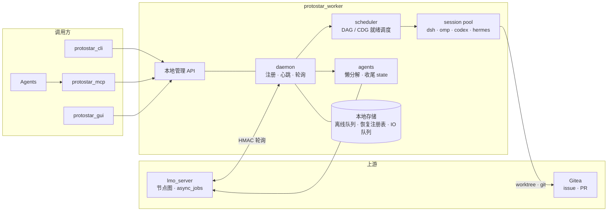

# 将明 · Protostar

将明（Protostar）是 AI 研发管线的执行端与通用调用层 —— 图优先调度、懒分解、多后端 agent 会话，并以 MCP server 供 agents 通用调用。

> Protostar is the execution layer for the AI development pipeline — graph-first scheduling, lazy decomposition, and multi-backend agent sessions, exposed to any agent via an MCP server.

```
原恒星（protostar）是分子云在引力下收缩、尚未点火却注定发光的天体。「将明」取长夜将尽、天将破晓之意：管线把混沌的需求凝聚、收缩、点燃为可交付的成果。本仓即这条管线的本体。
```

| 项 | 值 |
|---|---|
| 中文名 | 将明 |
| 代号 | Protostar（原恒星） |
| 前身 | `lmo_pipeline_runner`（语义 1:1 承接，实现重构） |
| 上游 | `lmo_server` 统一节点模型（project ⊃ pipeline ⊃ state ⊃ job） |
| 对外接口 | `protostar_cli`（命令行）· `protostar_mcp`（MCP server）· 本地 HTTP 管理 API |
| 治理 | spec-kit（`.specify/`）+ 本仓自举迭代，见 [`AGENTS.md`](AGENTS.md) |

> **当前状态**：仓库初始化——五个模块目录为空占位，尚未 `git init`，实现迁移中。下文中标注「规划中（Planned）」的接口为设计契约；落地进度见 [项目状态与路线图](#项目状态与路线图)。

---

## 目录

- [项目定位](#项目定位)
- [与泠喵观测站的关系](#与泠喵观测站的关系)
- [仓库结构](#仓库结构)
- [架构总览](#架构总览)
- [核心机制（语义保留）](#核心机制语义保留)
- [模块](#模块)
- [接口契约（规划中 / Planned）](#接口契约规划中--planned)
- [协议兼容（对接 lmo_server）](#协议兼容对接-lmo_server)
- [配置](#配置)
- [开发指引](#开发指引)
- [模块映射（原实现 → 本仓）](#模块映射原实现--本仓)
- [项目状态与路线图](#项目状态与路线图)
- [命名寓意：将明 · Protostar](#命名寓意将明--protostar)

---

## 项目定位

将明是研发管线的**执行端**：从上游拉取分配给本机的节点，按图调度，触发 agent 会话完成开发任务，回传进度、产出与结论。它把「需求 → 分解 → 执行 → 验证 → 合并 → 收尾」的全过程做成可恢复、可观测、可中断续跑的自动化链路。

- **图优先**：一切以节点图为真相。轮询拿到节点 → 按根拉取整图 → 本地缓存 → 判定就绪 → 调度执行。
- **懒分解**：未分解且无直接指令的 pipeline/state 节点，由主 agent 按固化工作流拆成子节点与边，而非预先全量拆解。
- **多后端**：主 agent / 执行 / 辅助三档可分别选用 dsh、omp、codex、hermes 后端，统一抽象为 session。
- **离线可用**：与上游断连时本地继续执行，状态变更落本地队列，重连后对账再串行补推。
- **可恢复**：重启不重跑已完成管线，pending/running 任务经本地注册表恢复。
- **通用调用**：`protostar_mcp` 把管线能力暴露为 MCP tools，任何 agent（dsh / Claude Code / codex / hermes）都能以标准协议驱动管线。

**边界**：本仓不负责节点图的持久化与全局调度中枢（当前仍由 `lmo_server` 承担）；`protostar_gui` 只做可视化与观测，不承载业务逻辑。

## 与泠喵观测站的关系

| 组件 | 角色 |
|---|---|
| `lmo_server` | 统一节点模型与异步任务中枢（图/节点/边、`async_jobs`、凭证、issue 扫描） |
| `lmo_pipeline_runner` | 管线执行端的前身（Go）；本仓承接其全部语义 |
| **将明（本仓）** | 执行端 + 命令行 + MCP + skills + 前端，构成可独立演进的管线工具集 |

对接方式沿用原语义：HMAC 签名调用上游接口，**上游不主动反连 runner**，全部由本仓轮询驱动。

## 仓库结构

```
protostar/
├── AGENTS.md              # agent 入口索引：自举迭代 + spec-kit + skills 约定
├── README.md
├── .specify/              # spec-kit 治理：constitution / templates / scripts
├── specs/                 # 项目级 spec（跨模块需求）
├── protostar_worker/      # 执行端：daemon、调度、懒分解、会话、存储、本地 API
│   └── specs/             # 本模块 spec（随模块版本走）
├── protostar_cli/         # 命令行：管线 / 节点 / 会话 / 调度 / 诊断
│   └── specs/
├── protostar_mcp/         # MCP server：tools + resources，agents 通用调用
│   └── specs/
├── protostar_skills/      # 项目自有 skill：agent 工作流指引（调用 CLI 执行）
│   └── specs/
└── protostar_gui/         # 前端：基于 DSH 与 CLI 的管线可视化与观测
    └── specs/
```

约定：**项目级 spec 放根 `specs/`，各子项目 spec 放各自模块目录下**，随模块版本一同演进。详见 [`AGENTS.md`](AGENTS.md)。

## 架构总览



## 核心机制（语义保留）

| 机制 | 语义 | 说明 |
|---|---|---|
| 统一节点模型对接 | project ⊃ pipeline ⊃ state ⊃ job，状态码 0-7，边表依赖（同管线 / 跨管线） | 与 `lmo_server` 完全一致；节点路径为树形，依赖为边 |
| 图优先执行 | 拉分配节点 → 按 path 根拉整图 → 本地缓存 → 就绪判定 → 调度 | 图是唯一真相，本地只做快照与增量 |
| 懒分解（主 agent 5 阶段） | 读 skill/issue/PRD → PRD 的 TDD 验收 → AutoPlan → 拆 state/job → issue 批量上报 | 产出动作 JSON，批量建图；已分解节点走增量更新 |
| 自调度器 | 判环决定 DAG（拓扑就绪、同层并行）或 CDG（循环持续执行）；worker 池 = 最大管线数 × 单管线并发 | 双信号量额度、停滞监控、迭代轮数上限 |
| 统一 session | 主 agent / 执行 / 辅助三档后端（dsh · omp · codex · hermes） | 持久线程与一次性进程统一抽象、统一进度与停止语义 |
| 挡位（tier）路由 | 按阶段分档：分解 max、主 agent high、state 由调度器推导、job 执行 low | 见下方挡位矩阵；模型与档位可经环境变量覆盖 |
| 待决策回传 | agent 抛出多选项问题 → 本地待决表 + 会话置阻塞 → CLI / MCP 列出、回答、取消 → 回传后端 | 订阅后端事件流（断线重连）；回答后会话恢复运行 |
| Gitea CI 触发 | 上游收到 webhook → 建 CI 节点并派发 → 本端按图执行并回传 | 本端只消费节点，不接收 webhook |
| 心跳与双缓冲上报 | 增量状态双缓冲交换后串行推送；周期全量心跳 | 上一批未清空即告警；辅助会话把进度摘要压缩到限长 |
| 离线队列与重连对账 | 断连期间本地照常执行，状态落队列；重连先注册 → 对账 → 串行补推 | 已暂停/取消/改派的回传被丢弃，不污染上游 |
| 重启恢复 | pending/running 管线经本地注册表持久化，重启后按「先来先恢复」排序放行 | 启动不重跑已完成管线 |
| input / output 流转 | 上游产出按边写入下游入参队列，多上游收齐才组装；同时写追溯记录 | 产出文件统一约定，超限截断并告警 |
| 收尾 state | `[总结]`（state / pipeline）、`[检查]`（等子管线 PR 合并）、`[PR 请求]`（建 PR 等人工合并）、`[回测]` | 非循环管线自动补建；循环管线无「末尾」语义，不补 |
| issue 关联与回写 | 需求编号权威在 issue；分解/执行/总结注入引用，执行期回写 start/end 评论 | PR 合并后按引用关单；缺失引用默认先查不跳过 |
| 异步任务轮询 | 拉取 → 认领（置 running）→ 执行 → 回写 done/failed；含 `ask` 问答 | 上游置 failed 即感知并取消本地在途会话 |
| spec-kit 接入检测 | 目标仓库无 `.specify/` 时，分解入口强制询问是否初始化 | 拒绝则停止分解并告知，不静默降级 |
| 本地管理 API | 状态 / 存储 / 配置 / 调度 / 会话 / 图 / 节点 / 问答 / 决策 | 供 CLI、MCP、GUI 共用；本地 token 鉴权 |
| 进程树守卫 | agent 子进程随 worker 退出被回收（Windows Job Object / Linux PDEATHSIG / macOS watchdog） | 强制终止也不留孤儿进程 |
| 提示词固化 | 分解 / 执行 / 提交 / issue 上报工作流以常量固化，执行与分解分离 | 固定前缀最前，利于提示词缓存 |

### 挡位矩阵（语义保留）

模型默认 `glm-5.3-flash`（provider 默认 `zai-coding-cn`），按阶段分层设置推理档位；键名为原实现键名，迁移期沿用，本仓自有键名在配置 spec 中冻结。

| 阶段 | 推理档位 | 覆盖键 / 来源 |
|---|---|---|
| 懒分解 / 分解 | max | `RUNNER_DECOMPOSE_MODEL` / `RUNNER_DECOMPOSE_REASONING_EFFORT` |
| pipeline 主 agent | high | `RUNNER_MAIN_AGENT_MODEL` / `RUNNER_MAIN_AGENT_REASONING_EFFORT` |
| state 节点 | 由调度器 `stateAwareReasoning` 推导 | 非固定值；节点 payload 可覆盖 |
| job（执行） | low | `RUNNER_EXECUTE_MODEL` / `RUNNER_EXECUTE_REASONING_EFFORT` |

后端能力差异：dsh 支持模型 + 推理档位；codex 原生支持；hermes CLI 仅支持模型（无推理档位参数，不得拼接）。

## 模块

### protostar_worker

执行端 daemon，本仓核心。职责：注册与心跳、节点轮询、整图缓存、懒分解触发、调度执行、会话池管理、进度上报、离线队列、重启恢复、IO 流转、收尾 state 补建、issue 回写、本地管理 API。

- 运行模式：`runner`（执行端）/ `manager`（本机 session 管理）
- 本地 API：状态、存储、配置、调度器、会话、图、节点、问答、决策
- 本地存储：离线队列、回传队列、恢复注册表、入参队列、图快照、会话注册表

### protostar_cli

命令行入口，覆盖原本地管理 API 的能力面，并作为 skills 的执行载体（skill 只写流程，动作走 CLI）。

- 管线与节点：创建 / 查询 / 更新 / 依赖 / 重跑 / 分解
- 会话与调度：会话列表与详情、子任务分发、调度器状态与提交、终止与回收
- 诊断：状态、存储占用、配置读写、错误上报、辅助问答
- 形态：`protostar <group> <command>`，JSON 与人类可读双输出

### protostar_mcp

MCP server，把管线能力暴露给任意 agent。

- transport：stdio（本地 agent）+ streamable HTTP（远端/多客户端）
- tools：项目 / 管线 / 节点 / 图 / 依赖 / 会话 / 调度 / 异步任务 / 问答 / 决策 / issue
- resources：整图快照、runner 状态、会话详情等只读视图

### protostar_skills

项目自有 skill 单一真源：agent 运行时 skill 包（工作流指引 + 经 CLI 执行动作的入口），随代码版本一同演进。

- **内容**：TDD 红绿灯、spec-kit 命令链、提交规范、issue 回写、收尾检查、懒分解工作流等 agent 指引。
- **来源**：原 runner 注入 agent 提示词的 skill 根目录（`RUNNER_LMTECH_SKILL_PATH` 指向的 lmtech skill）中**管线专属部分**，加上原 `internal/agents/prompt.go` 固化工作流里适合以 skill 形态交付的段落。
- **形态**：不是 runner 内部执行层——runner 只把 skill 根目录注入 agent 提示词（沿用原语义）；skill 的动作统一经 `protostar_cli` 执行。

### protostar_gui

基于 DSH 与 CLI 的前端：管线图可视化、节点与进度观测、会话查看、调度状态。

## 接口契约（规划中 / Planned）

> **状态：规划中（Planned）**。以下命令、工具与包名均为设计契约，尚未实现——当前仓库只有目录骨架（五个模块目录为空占位），且尚未初始化为 git 仓库。CLI 与 MCP 两套入口对齐同一语义。

### CLI

```bash
protostar worker run -f etc/protostar.yaml      # 执行端（runner）
protostar worker run --mode manager             # 本机 session 管理
protostar status                                # 本机状态与会话
protostar pipeline graph <root_id>              # 整图快照
protostar pipeline node decompose <node_id>     # 触发懒分解
protostar session dispatch --prompt "<task>"    # 分发子任务（异步 job）
protostar ask --pipeline <id> --question "..."  # 向辅助会话提问
protostar mcp serve --transport stdio           # 启动 MCP server
```

### MCP tools

| 分组 | 工具 | 说明 |
|---|---|---|
| 项目 / 管线 | `project_list` `project_create` `pipeline_create` `pipeline_get` `pipeline_prd` `pipeline_approve` | 需求登记到管线 |
| 图 / 节点 | `graph_get` `node_get` `node_patch` `node_rerun` `node_decompose` `graph_tasks_poll` | 图查询与节点操作 |
| 依赖 | `dependency_add` | 前驱 → 后继建边 |
| 会话 / 调度 | `session_list` `session_get` `session_dispatch` `session_dispatch_get` `session_stop` `scheduler_status` `scheduler_run` | 驱动与观测执行 |
| 异步任务 | `async_job_create` `async_job_list` `async_job_get` `async_job_report` | 统一异步任务模型 |
| 问答 / 诊断 | `ask` `runner_status` `storage_sizes` `report_error` `spenttime` | 进度问答与耗时核算 |
| issue | `issue_get` `issue_comment` `labels_list` | Gitea 需求与回写 |
| 决策 | `decisions_list` `decision_answer` `decision_cancel` | 待决策交互 |

## 协议兼容（对接 lmo_server）

> **本节不是 Planned 内容**：以下路由是 `lmo_server` **已声明/已实现的上游契约**，本仓只做消费与对齐，不新增、不修改协议；上一节「接口契约」才是本仓规划中的接口。

本仓是上游协议（`lmo_server`）的**消费方**，不改协议；迁移须逐条对齐以下已声明路由。鉴权为 HMAC 签名（runner secret）。

**runner 侧**

| 用途 | 路由 |
|---|---|
| 凭证 | `POST /pipeline/runner/server/issue-secret` · `POST /pipeline/runner/server/:id/refresh-secret` · `POST /pipeline/runner/server/:id/revoke-secret` |
| 注册 / 列表 | `POST /pipeline/runner/server/register` · `GET /pipeline/runner/server/list` |
| 心跳 / 会话 | `POST /pipeline/runner/server/:id/heartbeat` · `GET /pipeline/runner/server/:id/sessions` |
| 任务回传 | `GET /pipeline/runner/server/:id/jobs` · `GET /pipeline/runner/server/:id/jobs/:job_id` · `POST /pipeline/runner/server/:id/jobs/:job_id/report` · `POST /pipeline/runner/server/:id/report-error` |
| 派发 | `POST /pipeline/runner/server/:id/dispatch` |

**节点与图**

| 用途 | 路由 |
|---|---|
| 分配节点 | `GET /pipeline/runner/server/:id/nodes` |
| 节点回传 | `POST /pipeline/runner/server/:id/nodes/:node_id/report` |
| 整图 / 拓扑 | `GET /pipeline/manager/graphs/:root_id` · `GET /pipeline/manager/graphs/:root_id/topology` |
| 建边 / 建图任务 | `POST /pipeline/manager/graphs/:root_id/edges` · `POST /pipeline/manager/graph-tasks` · `GET /pipeline/manager/graph-tasks/:task_id` |
| 节点管理 | `POST /pipeline/manager/nodes` · `PATCH /pipeline/manager/nodes/:node_id` · `DELETE /pipeline/manager/nodes/:node_id` · `DELETE /pipeline/manager/edges/:from/:to` |
| 扩展值 | `POST /pipeline/nodes/:id/ext` · `GET /pipeline/nodes/:id/ext` |

**友好业务 API**

| 用途 | 路由 |
|---|---|
| 项目 | `POST /pipeline/project` · `GET /pipeline/project/list` · `GET` / `PATCH` / `DELETE /pipeline/project/:id` |
| 管线 | `POST /pipeline/pipeline` · `GET /pipeline/pipeline/list` · `GET` / `PATCH` / `DELETE /pipeline/pipeline/:id` · `POST /pipeline/pipeline/:id/prd` · `POST /pipeline/pipeline/:id/approve` · `POST /pipeline/pipeline/:id/rerun` |
| state | `POST /pipeline/state` · `GET /pipeline/state/list` · `PATCH` / `DELETE /pipeline/state/:id` · `POST /pipeline/state/:id/rerun` |
| job | `POST /pipeline/job` · `GET /pipeline/job/list` · `PATCH` / `DELETE /pipeline/job/:id` · `POST /pipeline/job/:id/rerun` |
| 依赖 | `POST /pipeline/dependency` |

**异步任务**

| 用途 | 路由 |
|---|---|
| 创建 / 列表 / 详情 | `POST /async/jobs` · `GET /async/jobs` · `GET /async/jobs/:id` |
| 回写 / 删除 | `POST /async/jobs/:id/report` · `DELETE /async/jobs/:id` |

**Gitea webhook**（上游接收，本端不接收）：`POST /pipeline/manager/webhooks/gitea` → 上游建 CI 节点并派发 → 本端按图执行并回传。

## 配置

环境变量加载优先级（沿用原语义）：**系统环境变量 > 平台配置目录 > 运行目录 `.env` > 默认值**。

| 配置域 | 内容 |
|---|---|
| 上游连接 | 服务地址、runner 注册名、HMAC 凭证（只经环境变量/平台配置通道，不入库） |
| 运行模式 | 执行端 / manager、轮询间隔、上传间隔 |
| 并发额度 | 最大管线数、单管线并发、总 session 额度 |
| 后端选择 | 主 agent / 执行 / 辅助三档后端及其模型、可执行路径 |
| 存储 | 数据目录、会话内容与日志目录 |
| 进度 | 进度摘要开关与字数上限、上下文压缩阈值、停滞与轮次上限 |
| 凭据 | git / Gitea 凭据按「默认凭据名 + 前缀键」解析 |

## 开发指引

### 环境

- Python ≥ 3.11，依赖管理用 `uv`（本机 `uv 0.11.32`）
- 工作区：`uv sync` 后 `protostar <command>` 可用（目标形态）

### spec-kit 工作流

本仓 spec 走 spec-kit 命令链，治理真源在 `.specify/memory/constitution.md`：

```
constitution → specify → clarify → plan → tasks → implement → analyze → checklist → taskstoissues
```

- 产物链单向派生：`spec.md`（做什么 + 验收）→ `plan.md`（技术方案）→ `tasks.md`（bite-sized 任务，每条标 RED/GREEN/REFACTOR）→ 代码
- 一个 agent 一个产物；plan 未过审批不动手；无 spec 不改码
- 项目级 spec 在根 `specs/`，子项目 spec 在 `<模块>/specs/`，编号域内 sequential

### TDD

RED（先写失败测试）→ GREEN（最小实现）→ REFACTOR（清理）。交付四查：实现点、测试/构建输出、版本状态、文档留痕。

### 提交规范

LMTech 标签前缀式：`[{Tag}] 描述`，Tag ∈ `[Add]` `[Feature]` `[Update]` `[Fix]` `[Rename]` `[Create]` `[Import]`；正文用项目符号列变更。

## 模块映射（原实现 → 本仓）

| 原实现（Go） | 本仓 | 说明 |
|---|---|---|
| `internal/client` | `protostar_worker/client` | HMAC 签名与上游接口调用 |
| `internal/runner` | `protostar_worker/daemon` | 主循环、心跳、离线队列、重启恢复 |
| `internal/scheduler` | `protostar_worker/scheduler` | 图调度、并发额度、停滞监控 |
| `internal/agents` | `protostar_worker/agents` | 懒分解、收尾 state、提示词、issue 回写 |
| `internal/session` + `internal/codex` | `protostar_worker/sessions` | 多后端会话抽象与进程管理 |
| `internal/store` | `protostar_worker/store` | 本地持久化（队列 / 注册表 / 快照） |
| `internal/gitea` + `internal/worktree` | `protostar_worker/gitea` `.../worktree` | PR / issue / worktree 操作 |
| `internal/handler` + `internal/logic` | `protostar_worker/api` + `protostar_cli` | 本地管理 API 与命令行 |
| `cmd/*` | `protostar_cli` 子命令 | 诊断与压测工具 |
| `internal/agents/prompt.go` 的 skill 注入 + `RUNNER_LMTECH_SKILL_PATH` 指向的 lmtech skill 管线专属部分 | `protostar_skills` | agent 运行时 skill 包；动作经 CLI 执行 |
| — | `protostar_mcp` `protostar_gui` | 新增能力 |

## 项目状态与路线图

| 项 | 状态 |
|---|---|
| 仓库骨架（五个模块目录） | ✅ 已建立 |
| 项目级 spec-kit 治理（constitution / templates） | ⏳ 待初始化 |
| `protostar_worker` 执行端 | ⏳ 迁移中 |
| `protostar_cli` 命令行 | ⏳ 迁移中 |
| `protostar_mcp` MCP server | ⏳ 待开发 |
| `protostar_skills` 项目 skills | ⏳ 待开发 |
| `protostar_gui` 前端 | ⏳ 待开发 |
| 管线与 PM 后端脱离 `lmo_server` 独立 | ⏳ 规划中（当前仍对接既有接口） |

## 命名寓意：将明 · Protostar

**字义**。「将」是即将、将要；「明」是光明、天明。二字合起来是黎明前的那一刻——天将亮而未亮。

**天文对应**。原恒星（protostar）是分子云在引力下收缩形成、核心尚未点火聚变、却注定成为主序星的阶段。它的定义就是「主序星点火前夜」——与「将明」严丝合缝。

**古籍意象**。先秦诗文中「东方未明」（《诗经·齐风》）、「夜乡晨」（《诗经·小雅·庭燎》）皆写此候：长夜将尽、天光未至。取此意，管线所做的正是把混沌（分子云）凝聚、收缩，推向发光（恒星）。

**工程寓意**。管线把未成型的需求一步步推向「可交付」：凝聚 → 收缩 → 点火。每一次执行，都是把「将明」变成「已明」。

**自举传承**。将明用自己开发自己——需求进管线，产物出管线，一代代迭代。薪火相传，火种在灰中，只待一拨。

---

相关仓库：[`lmo_server`](https://gitea.lmtech.ricardo2001zg.com/LingMiaoTech/lmo_server) · `lmo_pipeline_runner`（[泠喵观测站](https://gitea.lmtech.ricardo2001zg.com/LingMiaoTech/LingMeowObservatory) 子模块） · 治理与协作见 [`AGENTS.md`](AGENTS.md)
