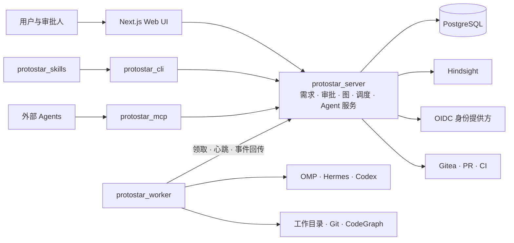

# Protostar 产品需求文档

**文档所有者**：泠鱼科技（LingKoiTech）。  
**文档状态**：公开独立文档；产品需求草案，实现与治理尚待批准。本文件已完成公开文档独立化；文档完成不代表系统已实现、运行或验收。  
**编写日期**：2026-11-10；公开文档独立化：2026-11-12。  
**产品名称**：将明 · Protostar。  
**关联需求**：[001：Protostar 产品需求总览与六模块迁移规划](../specs/001-protostar-server-init-migration/spec.md)。  
**文档来源**：本文结论为独立撰写。产品决定记录、行为研究转述与资料分别以 [产品决定记录](sources/product-decisions.md)、[行为研究转述](sources/behavior-notes.md) 与 [公开来源清单](sources/README.md) 登记；`docs/archive/` 保存按映射改名的公开整理副本，原文只保存在本机 `docs/temp/archive/`。本机映射、逐行差异及 API／编号计数用于核对副本，双 SHA-256 用于核对字节；这些资料不构成本产品的当前运行依赖或已实现能力。  
**文档边界**：本文档是独立公开的产品需求草案，不包含产品开发、数据切换、治理定稿或提交。本文不改变 001 的 Draft 状态；当前 constitution 仍是含占位符的模板骨架，本文不代替后续 spec、plan、tasks 与治理正文的批准。

## 1. 产品目标与已经确认的选择

Protostar 是自动化 AI 研发系统。用户登记需求后，系统组织需求整理、方案设计、任务分工、代码开发、过程监督、测试和交付，将需要人类决定的内容集中呈现。主要收益是减少反复查找文件、阅读重复上下文、追问执行进度和处理重复审批的时间，同时保留人类对研发范围、技术方案、执行任务及交付的决定权。

| 事项 | 本次确认的产品选择 |
|---|---|
| 使用形式 | 自行开发 Next.js Web UI，浏览器连接 server，本机或远程 worker 执行任务 |
| 后端语言 | server、worker、CLI 与 MCP 使用 Python，使用 uv 管理 Python 工作区 |
| 账户范围 | 支持多个相互隔离的组织；用户可以注册、创建组织并加入其他组织 |
| 需求权威 | Protostar 自主管理需求正文、编号、优先级和历史；Gitea issue 是可关联的外部记录 |
| 执行后端 | OMP、Hermes、Codex，通过直接适配器运行，按任务选择 |
| 快速分类 | 可配置的小型模型分类器，并提供 Jev 适配；具体 provider、model 和版本通过组织配置选择 |
| UI 风格 | 新拟态；流程图管理研发过程，知识图展示记忆关系，ECharts 展示实际数据 |
| 人工决定 | spec、plan、tasks 分别批准；代码合入、发布和关单保留显式人类授权 |
| 项目归属 | 六个模块均属于 Protostar；Pipeline 与 PM 服务端能力由 protostar_server 原生实现 |
| 自举 | 用可运行的 Protostar 管理并执行自身后续开发，所有运行保留对应的需求和流程版本 |

### 1.1 用户与日常工作

- **组织负责人**：建立组织，配置模型、知识服务和 worker，邀请成员，授予项目权限，决定组织流程优化。
- **项目负责人／审批人**：登记与确认需求，审阅具体方案与任务，处理执行中必须决定的事项，确认交付。
- **研发成员**：补充需求，查看图与运行记录，按权限启动、暂停和终止任务，检查代码与测试输出。
- **查看者**：读取获准项目的需求、进度、交付结果和知识，不获得执行或审批权限。
- **执行 Agent 与监督助手**：按授权调用工具、提交产物和建议；服务身份不具有人的审批权限。

### 1.2 本产品要完成的工作

1. 建立原生需求管理：项目、需求编号、需求／漏洞类型、P0/P1/P2、来源与变更历史。
2. 将 spec、plan、tasks 的生成与批准变成可见、可追踪的研发流程。
3. 以 Protostar 原生 Python 模块实现 Pipeline、PM 与 runner 的业务行为，并明确 server 与 worker 的负责范围；旧系统只通过可选导入接口提供已批准数据。
4. 实现按任务分配后端、调度执行、会话观测、测试、PR 和交付记录。
5. 改善图读取方式：按需读取、分页和版本增量，避免日常操作反复获取完整大图。
6. 提供项目知识管理、代码理解工具、监督助手和组织流程学习。
7. 用真实开发任务证明知识与代码索引的作用，在界面展示可追溯的对照数据。

## 2. 研究依据与当前实际状态

### 2.1 依据的使用范围

| 编号 | 依据 | 本文使用的内容 |
|---|---|---|
| [S01](../specs/001-protostar-server-init-migration/spec.md) | 001 需求说明 | 六模块责任、Pipeline／PM 独立、真实实现调查、引导期、自举和人工审批 |
| [S02](sources/product-decisions.md) | 独立整理的产品决定记录 | 审批效率、完整研发过程、Next.js 确定前的 UI 目标、模型路由、账户、知识、监督、流程学习和效率案例 |
| [S03](sources/product-decisions.md) | 独立整理的产品决定记录 | Next.js、Python、多组织、Protostar 原生需求权威、可配置小型分类器 |
| [S04](sources/behavior-notes.md) | 历史实现行为研究转述 | 节点图、PM、图任务、后端会话、队列、恢复、权限和接口的行为描述 |
| [S05](sources/behavior-notes.md) | 历史图界面与会话轨迹行为研究转述 | 图读取问题、Message／Tool Call 事件类型和可观测信息 |
| [S06](sources/README.md) | 四份历史资料 | Pipeline PRD、CI 计划、审批记录和超长程调度需求；按事项提取本项目相关内容 |
| [S07](sources/README.md) | Hindsight、Jev、Next.js、React Flow、ECharts、MCP 官方材料 | 集成能力、限制和选用库的实际接口方向，见第 17 节 |

S01–S07 是本文使用的引用编号。S02 与 S03 是独立整理的产品决定记录，不是历史会话原文摘录；S04 与 S05 是历史研究转述，不代表本次重新验证。各项公开来源与术语处理见对应文件及 [公开来源清单](sources/README.md)。本文只提取与产品有关的需求，不复制历史会话或私人正文全文，不扩大资料发布或记忆写入权限；本文不引用仓外本机路径，也不要求读取任何本机文件。

### 2.2 已经调查到的实现与当前状态

| 范围 | 已有证据 | 对本次研发的意义 |
|---|---|---|
| Protostar 本仓 | 五个应用模块目录为空，protostar_server 尚无应用实现；Spec Kit 已接入，constitution 仍为模板 | 以下功能都是待开发工作，目录和文档不能作为运行证据 |
| Pipeline／PM | 历史实现存在节点、边、PM 四表、异步图任务、审批入口与执行端 API（[S04](sources/behavior-notes.md)） | 以行为描述为原生实现依据，使用 Python 重新实现，保留关联身份与历史来源；本仓尚未实现 |
| worker | 历史执行端存在调度、会话、离线报告、重启恢复、Gitea 和 worktree 处理（[S04](sources/behavior-notes.md)） | 逐项实现运行行为；历史代码不是本仓 Python 运行模块 |
| 多后端 | 历史执行端有 OMP／Hermes／Codex 相关实现，当前入口按单个运行时后端组织 | 新增真正的任务级路由与能力检查 |
| 图读取 | 历史服务端支持 depth 与单层截断；历史图界面同时请求 graph 和 topology，后者再次读取图（[S04](sources/behavior-notes.md)、[S05](sources/behavior-notes.md)） | 新设计需要独立的分页、增量与统一图响应；旧 graph_rev 不能直接当作增量游标 |
| OAuth | 历史登录入口可生成 Logto 跳转地址（[S04](sources/behavior-notes.md)） | 完整登录回调、身份绑定、多组织和项目权限需要开发 |
| Hindsight | 本次调查仅有客户端与插件资料；官方支持记忆、来源文档、实体图、记忆图和 Pages | 使用官方服务能力开发项目知识界面；本次未接入 Hindsight 服务，部署能力必须核实 |
| CodeGraph | 本仓索引为 1 个文件、0 个节点、0 条边；查询无相关代码结果 | 索引工具已可调用，当前尚无产品源码供其查询；这不等于代码理解功能已经完成 |

以上“历史实现”只描述被研究过的行为，不代表本仓已复制、迁入或运行这些能力。没有运行本产品的开发任务、图性能测试或效率对照实验；本文所有性能数值均为建议的产品目标或实验设计，均不表示已经测得。

## 3. 模块划分与原生实现工作

### 3.1 六个模块

| 模块 | 负责的业务 | 原生实现基础 | 需要完成的研发 |
|---|---|---|---|
| protostar_server | 组织与账户、项目与需求、审批、Pipeline 图、任务派发、运行投影、知识连接、流程优化、监督 Agent 服务 | Protostar 原生 Python API 与数据模型；可选旧系统导入接口只接收已批准数据 | 使用 Python 建立统一 API 与数据库；新增多组织、产物版本、完整审批、图增量、原生需求和 Agent 服务 |
| protostar_worker | 本机执行、后端进程、工作目录、会话、日志、本地恢复、CodeGraph 索引与查询 | Protostar 原生 Python 执行运行时；OMP／Hermes／Codex 适配器 | 实现任务级 OMP／Hermes／Codex 路由、受限工作目录、事件回传和中断恢复 |
| protostar_cli | 用户与 skills 的命令行入口 | Protostar 原生 CLI；操作语义参考历史启动参数与本地管理接口的行为摘要 | 编写完整子命令；同时支持 JSON 与可阅读输出、稳定退出码和长任务状态查询 |
| protostar_mcp | Agent 使用的 tools 与 resources；本地 stdio 与远程 Streamable HTTP | Protostar 原生 MCP server | 使用官方 Python MCP SDK；与 server／worker 共用业务操作和权限检查 |
| protostar_skills | spec-kit 工作流、软件工程方法、代码研究、执行、测试与交付指引 | Protostar 自持 skills；参考历史管线工作流提示的行为摘要 | 整理成项目自持的版本化 skills；动作调用 CLI，不在提示中复制服务逻辑 |
| protostar_gui | Next.js 用户界面：需求、审批、流程图、会话、知识、代码、监督与统计 | Protostar 原生 Next.js／TypeScript 界面；没有既有界面可直接交付 | 自行编写 Next.js／TypeScript UI，使用 React Flow 和 ECharts，实行新拟态设计 |

Agent server 是 protostar_server 内的一组应用能力：保存预设、安排监督与学习会话、控制上下文权限。实际模型会话仍由 worker 的后端适配器执行。MCP 是调用方式，不额外建立一份需求、审批或会话数据库。

### 3.2 可选旧系统导入与行为继承

| 历史能力 | Protostar 原生处理 | 导入时必须保留的内容 |
|---|---|---|
| PM 主记录、扩展元数据、变更历史和 Git 关联 | 由原生需求管理接收；建立组织／项目归属与新需求编号 | 原 task_id、原始状态、历史时间、Git SHA、外部 issue 引用和源版本 |
| project／pipeline／state／job 节点及边 | 由 server 图与任务模型原生实现 | 原节点 ID、层级与依赖、输入输出、执行历史、循环任务含义 |
| 图变更任务与校验 | 由 server 内的事务性图操作原生实现 | 父子范围、依赖有效性、并发版本检查、入口出口与循环关系 |
| runner 注册、心跳和分配 | 由 server 的组织绑定 worker 注册与任务领取原生实现 | worker 身份、任务与会话对应关系；旧凭据不作为新系统默认凭据 |
| 执行调度与会话池 | 由 protostar_worker 原生实现 | 并发限额、取消、后端原生会话 ID、退出结果、进程清理 |
| 离线队列与恢复记录 | 由 worker 的 SQLite 状态与事件队列原生实现 | 未确认报告、尝试编号、已完成状态、恢复顺序和去重信息 |
| Gitea PR／CI／issue | 可选外部连接，不是运行依赖 | 仓库、分支、commit、PR、CI run 和 issue 的精确关联 |
| 管线专用提示词与 skill | 整理进 protostar_skills | 工作流语义、输入产物、人工决定位置、验证与交付要求 |

上述历史能力只作为行为研究与可选导入的数据形态；Protostar 不依赖任何旧系统运行，本仓也不会因导入接口存在而被视为已实现对应功能。导入接口只接收经批准的导出数据，不能成为第二个业务权威。本产品不包含与研发流程无关的其他业务系统迁移。Gitea 的构建、PR 和 issue 连接属于可选研发集成，原生需求即使没有 Gitea issue 也能建立和规划。

### 3.3 可选数据切换与旧系统退出

1. 按组织、项目、任务、图、会话、运行、外部引用建立导入清单；先确认每批资料的项目归属和可使用权限。
2. 导入工具从已批准的数据库导出与执行端本地记录读取数据，保留源 ID 映射；同一批重复运行不会生成重复需求和节点。
3. 给导入批次指定 Protostar 组织及项目，无法判定归属的记录停止导入并列出具体对象，不能放入默认公共组织。
4. 对待迁项目暂停旧端新任务领取，等待当前工作完成或由人类明确终止；冻结最后版本并核对记录数量、依赖、产物和未确认报告。
5. 同时更新 worker、CLI、MCP、界面及相关 skill 的目标服务配置。切换完成后，同一项目的 Pipeline／PM 写入只有 protostar_server 接受。
6. 旧端移除该项目的可写入口、调度与凭据；历史证据可只读留存。没有完成调用方迁移的项目继续留在原系统，不处于两个服务同时写入的状态。
7. 切换异常时停止新任务派发并保留实际变更记录，由人类决定修复或受控恢复；不能自动重放有远端副作用的任务。

## 4. 最小运行方案

### 4.1 进程与依赖

常驻应用为 Next.js UI、Python server、Python worker。CLI 按需运行，MCP 按调用方式运行。开发机器也使用同一套职责，不另外开发单机业务实现。

| 部分 | 采用方案 | 简化工作的方式 |
|---|---|---|
| Python 服务 | FastAPI、Pydantic、SQLAlchemy、psycopg、Alembic；Python 3.11+、uv | 一个 server 应用负责业务与短事务；长任务交给 worker |
| 业务数据 | PostgreSQL，使用 ltree／JSONB 表达层级与扩展字段 | 需求、图、审批、事件和调度队列共用数据库，不新增消息中间件 |
| worker 状态 | SQLite、本机受限产物目录、子进程管理 | 事务记录领取、事件队列和恢复状态，替代分散的 CSV 写入 |
| Web UI | Next.js App Router、TypeScript、React Flow、ECharts | 页面与交互自行编写，业务状态以 Python API 为准 |
| 登录 | OAuth2／OIDC Authorization Code＋PKCE，默认适配 Logto（可替换的 OIDC 实现），使用成熟 OIDC 库 | 身份提供方负责登录凭据和注册验证，Protostar 管理自身用户、组织与权限 |
| 知识 | Hindsight 官方 API／客户端，按组织和项目建立 bank 映射 | 复用来源、抽取、检索与图能力，不复制记忆数据库 |
| 代码理解 | worker 调用 CodeGraph CLI／MCP | 索引位于相应代码工作区，查询结果附代码版本 |
| 快速分类 | Jev 官方 Python SDK＋可配置的结构化小模型适配 | 统一分类结果，不绑定单个模型名称或供应商 |
| 模型执行 | OMP、Hermes、Codex 的正式 CLI／SDK／事件接口 | 复用后端自身的模型调用、会话与工具能力，worker 统一调度和记录 |

UI 与 Python API 通过同源网关提供，`/api/v1` 进入 Python 服务；Next.js 处理页面、界面会话传递和展示。组织权限、审批规则、任务状态、知识访问均在 Python 服务再次校验。组织页面与查询不能使用跨账户的公共响应缓存。

### 4.2 最小可运行研发流程

该流程交付后，用户应能在真实代码仓内完成一次有审批、有执行、有测试、有交付记录的研发工作。

| 顺序 | 用户或系统完成的具体工作 | 实际产出 |
|---|---|---|
| 1 | 用户注册并创建组织，建立项目、绑定仓库和 worker，选择可用后端与模型 | 可访问项目、可领取任务的 worker 和明确的运行配置 |
| 2 | 在 Protostar 新建一项需求，填写目标、影响范围、类型和优先级 | 原生需求编号及首个内容版本 |
| 3 | 系统检查材料、查询代码与已授权知识，集中列出不能从资料判断的问题 | 一次成组的澄清请求及回答记录 |
| 4 | Agent 整理 spec，审批人查看目标、范围、未解决事项与关键内容并批准 | 已批准的 spec 版本 |
| 5 | Agent 根据批准内容编写 plan，展示模块职责、改动范围、数据和接口方案 | 已批准的 plan 版本 |
| 6 | Agent 编写 tasks，说明每项实际研发与验证工作，审批人批准完整任务集 | 可执行的任务与依赖图 |
| 7 | 用户启动运行，系统按任务路由到已配置的 OMP、Hermes 或 Codex | 固定版本的运行、job、session 和实时事件 |
| 8 | Agent 在隔离工作目录内实现功能、运行项目检查并提交产物 | 代码差异、测试结果、失败原因或交付说明 |
| 9 | 用户通过审批与运行页面查看具体结果，确认合入或退回修改 | PR／commit 关联或经确认的产物，不自动合入 |
| 10 | 系统保存运行、审批耗时与知识使用记录，为自举与效率对照提供实际来源 | 可追溯的研发历史 |

002 的首轮构建使用现有 spec-kit 和人工启动方式准备并批准 002 的 spec／plan／tasks，不能预先声称由尚未运行的 Protostar 开发 002。002 启动后，先用自举流程整理 003 spec 并由 Plan／Tasks subagent 依序生成对应产物，批准后再由 OMP worker 执行 003 的真实功能与检查；从此后的每轮都在 Protostar 内完成需求到验收。基础流程仍须人工批准，任务不能由两个执行器同时领取。

知识图、监督助手、流程学习和效率对照都在本 PRD 的交付范围内，按第 15 节的依赖顺序完成；它们有明确功能和产物，不以空页面或模拟数据代替。

### 4.3 核心数据与操作边界

| 业务对象 | 最小保存内容 | 唯一负责者 |
|---|---|---|
| User／ExternalIdentity | 用户资料、issuer＋subject、账户状态 | server；登录凭据由身份提供方处理 |
| Organization／Membership | 组织、成员、角色、邀请与权限变更 | server |
| Project／ProjectMembership | 项目代码、仓库引用、项目成员与审批授权 | server |
| Requirement／RequirementVersion | 原生编号、正文、类型、优先级、来源与版本 | server |
| ArtifactVersion／Approval | spec／plan／tasks 内容与哈希、基准版本、人类决定及时间 | server；文件提供可阅读交付物 |
| WorkflowVersion／PipelineRun | 流程模板与版本、运行固定的产物与配置版本 | server |
| Node／Edge／GraphChange | 层级、依赖、图变化序列与读取范围 | server |
| JobAttempt／Worker | 任务尝试、领取租约、worker 授权、执行结果 | server 管派发与结果；worker 管本机实际执行 |
| AgentSession／RunEvent | 原生 session 引用、顺序事件、命令结果与用量 | worker 负责活会话；server 保存投影及历史 |
| BackendPreset／Classification | 配置版本、能力、分类输入版本与实际建议 | server；密钥仅保存安全引用 |
| KnowledgeBinding | 组织／项目到 bank 的映射、访问范围与外部对象引用 | server；知识正文与派生图由 Hindsight 负责 |
| OptimizationProposal | 来源运行、流程差异、处理意见与再次提醒时间 | server |
| BenchmarkRun／ExternalReference | 实验分组与原始运行、仓库／PR／CI／issue 的引用 | server |

每个业务写入明确所属组织、对象版本和操作身份。审批、任务领取、图变化与事件确认使用短事务；不在数据库事务内等待模型、Hindsight 或 Git 网络操作。外部操作保存 operation_id 或等价关联，界面区分“已接受”“处理中”“已完成”“失败”。

Web、CLI、MCP 共用这些操作：需求登记、产物提交、请求审批、作出人类决定、启动已批准运行、读取图与事件、控制任务、查询知识和代码。写入提交携带幂等操作 ID 与预期版本；重复请求返回同一操作结果，版本冲突明确提示，不覆盖新的正文或决定。

worker 使用主动连接的领取／心跳／事件回传协议，server 不要求从公网连接本机。界面使用 HTTP 分页与 SSE 获取状态；worker 的长轮询与消息读取均有明确超时。普通列表单页最多 200 项，事件按批次确认，大输出按有界块保存；服务配置对排队量、事件与产物存储设置限额，达到限额时明确停止接收相应工作，不无限占用存储。

## 5. 原生需求与 spec-kit 研发管理

### 5.1 需求登记与编号

- 每个组织拥有稳定的组织标识，每个项目拥有项目代码；需求使用项目内递增编号，例如界面显示 `PRO-42`，API 同时携带组织、项目与不可变 ID。
- 需求字段包括标题、说明、目标、范围、类型、优先级、来源、负责人、项目、状态、外部引用和历史版本。
- 类型包含 feature、bug、improvement、research；界面分别显示“需求、漏洞、改进、调研”。P0 表示紧急或阻塞，P1 表示当前重要工作，P2 表示正常排队工作。
- 优先级只决定队列排序与提醒位置，不赋予审批权限，也不自动选择高权限工具。复杂度、执行风险、模型档位单独记录。
- 手工设置的字段优先于自动建议。分类建议显示来源与版本，用户可直接修改并保留修改原因。
- 需求内容修改形成新版本，运行中引用的需求版本不会随编辑而改变。影响已批准范围的改动重新进入相应审批。

### 5.2 spec、plan、tasks 的组织

系统保留 Markdown 产物与 spec-kit 工作方式，并将其内容版本、哈希、提交者和审批结果登记到 server。文件是可阅读交付物，数据库提供版本索引与运行控制。

| 产物 | 编写的具体内容 | 用户主要决定什么 |
|---|---|---|
| spec | 用户要完成的工作、用户流程、范围、模块关系、资料来源与功能边界 | 是否按这个范围研发 |
| plan | 真实源码调查、使用的技术、模块职责、数据与接口、UI、迁移和验证方案 | 是否采用这个实现方案 |
| tasks | 按依赖排列的具体工作、负责者、输入输出、运行命令和验证方式 | 是否允许执行这些任务 |

编写流程遵循项目中的作者与审核职责，默认上层批准后才生成下层。主线程组织材料与审核，plan／tasks 由被分派的对应作者生成。自动生成的摘要或人工检查结果不能替代审批记录。

研发启动前存在多个问题时，系统在完成可读取材料与代码调查后生成一份问题清单；已能从资料决定的技术信息由方案说明，不反复打断用户。答案写回当前产物和需求版本，同一问题不重复询问。

### 5.3 产物版本与变更

- 每个提交版本记录完整内容、相对代码仓的路径、SHA-256、基准版本、提交时间及生成 session。
- 审批绑定确切版本和哈希。批准以后编辑同一文件，新的正文不会继承原批准状态。
- 运行固定 requirement_version、workflow_version、spec_version、plan_version、tasks_version、backend_preset_version 和 skill_versions。
- 上层范围变化时，系统列出受影响的下层产物；用户批准修订后再生成或调整对应 plan／tasks，不能让旧运行自动读取新文件。
- 产物接口返回内容与相对路径；本机绝对目录由 worker 配置管理，不写入共享 PRD 或需求文件。

## 6. 人工审批与审批效率

### 6.1 审批对象

| 审批内容 | 审批时实际展示 | 批准后的效果 |
|---|---|---|
| 需求范围与 spec | 要做的工作、使用场景、范围、当前需要决定的问题、完整正文 | 允许生成对应 plan |
| 实现方案与 plan | 具体技术方案、模块迁移、UI、改动文件、数据影响、关键风险 | 允许生成对应 tasks |
| 执行任务与 tasks | 每项研发工作、依赖、负责者、命令、产物、测试与外部动作 | 允许显式启动这个任务版本的运行 |
| 执行中范围变更 | 当前工作、新增内容、修改原因、差异和影响 | 允许执行经批准的变更任务 |
| 代码交付 | 功能说明、代码差异、实际检查输出、PR 和未解决问题 | 由人类确认合入、退回或单独授权发布 |
| 组织流程优化 | 旧流程、新流程、真实依据、影响范围与生效版本 | 新建可用于后续运行的流程版本 |

批准 tasks 与启动运行分别记录。审批不会顺带执行合入、发布、关单或组织权限调整。界面与 API 均禁止服务身份代替人类产生批准结果。

### 6.2 减少阅读与操作时间

1. 审批中心集中显示等待本人处理的事项，以优先级、阻塞影响和等待时间排序。
2. 首屏呈现“本次要决定什么、具体完成哪些工作、改动与影响、需要注意的问题”；完整文件与差异可直接展开。
3. 相比上一版本，只突出本次新增与改变的内容，同时保留完整正文，防止摘要遗漏关键修改。
4. 每个代码或设计结论都能进入来源、原始 Tool Call、文件差异与测试输出。
5. 多项材料可在同一会话阅读；每项批准分别绑定版本，不跨越 spec→plan→tasks 的顺序。
6. 相同运行事件只产生一个待决定事项；新证据追加到原事项，不生成重复提醒。
7. 人类退回时填写修改意见；Agent 按意见修订，系统呈现已处理的意见与仍需决定的问题。

正常审批状态为 pending、approved、rejected、superseded。超时只表示继续等待并提醒指定人员，不能变成自动通过。材料缺失、权限失效或版本变化时不提交批准。

## 7. 调度、模型路由与 worker 执行

### 7.1 调度对象与状态

- project 管理研发范围；pipeline 是一个需求或工作流；state 表示可阅读阶段；job 是可以由一次执行尝试承担的实际工作。
- 层级关系与执行依赖分开维护。一个任务只有所有前置条件满足并通过必要审批才可领取。
- 单次工作采用 DAG；需要持续运行的流程必须明确循环入口、退出条件与迭代上限，不能把意外循环当作合法持续任务。
- 新运行使用 waiting、ready、running、waiting_approval、paused、failed、cancelled、succeeded 等明确状态；旧系统状态通过显式映射导入，保留原值，不能直接改变旧记录含义。
- job_attempt 保存一次尝试的 backend、model、worker、session、输入版本、开始结束、结果与原因。重跑会产生新的 attempt，不覆盖失败证据。
- 全局、组织、项目、worker 与单个 pipeline 的并发额度独立限制，排队原因在界面可见；P0 不绕过权限与前置依赖。

### 7.2 Jev 与小模型分类

联网已确认 Jev 是 TypeSafe 的 System One 决策模型。它对 state 与 typed questions 返回结构化判断；Choice 可提供类别、概率分布与 confidence。它适合快速分类和路由建议，不能替代方案设计、代码执行或人工批准。官方资料见第 17 节。

分类器分别判断以下维度：

| 维度 | 输出 | 系统如何使用 |
|---|---|---|
| 工作类型 | feature／bug／improvement／research | 提供需求类型建议 |
| 优先级 | P0／P1／P2 候选 | 排队建议；不会覆盖人类已经确认的优先级 |
| 任务复杂度 | simple／standard／complex／unknown | 选择允许的模型档位候选 |
| 所需能力 | 文件修改、命令执行、长会话、图片输入、MCP 等标签 | 过滤不满足能力的后端 |

- 使用 Jev 时采用官方 Python SDK 和 typed question 定义；通用小模型通过已配置 provider 的结构化输出接入。同一内部结果模型承接两种输出。
- 保存实际 provider、model、返回版本、问题定义版本、输入哈希、结果、耗时和可获得的用量；不把 `jev-latest` 作为不可追溯的历史模型版本。
- confidence 缺失就显示“未提供”；模型自报置信度与经过标注样本校准的可靠性分别记录，不用未校准数字作安全授权。
- 原始需求明确填写类型或优先级时，只补充建议。分类失败、低置信度或无覆盖类别时，状态为“待人工确认”，不静默调用另一个付费模型。
- 分类器只接收该任务所需并经组织允许的数据；密钥和无关终端输出不进入分类请求。

### 7.3 后端与模型预设

每个组织配置 backend_preset，内容包括 backend 类型、可执行程序或服务、模型、provider、能力、并发额度、上下文规则和凭据引用。路由顺序为：用户明确指定→项目规则→组织规则→分类建议匹配；无法匹配时明确阻塞。

| 后端 | 需要实现的行为 |
|---|---|
| OMP | 启动任务、传入工作目录／模型／授权 MCP、读取消息与工具事件、停止进程；没有原生恢复能力的配置不显示“继续原会话” |
| Hermes | 启动、记录原生 session 标识、读取事件、按支持能力恢复或停止；不传入其不支持的推理参数 |
| Codex | 通过正式 CLI／SDK 管理 session、执行与事件、批准请求和取消；模型配置按实际能力传递 |

分类器本身与研发后端分别配置。一次 running attempt 不自动换后端；用户改变路由后创建新的 attempt，并保留旧 attempt 的输出及原因。下游任务可以使用不同后端。

### 7.4 worker、离线与恢复

1. worker 凭据绑定一个组织和被授权的项目／工作目录；server 分配任务时给出带尝试编号的领取租约。
2. worker 用 SQLite 事务记录任务、子进程、原生 session、事件序列和未确认报告。事件先写入本地，再回传并按服务端确认位置清理。
3. 断开连接时已开始的本地会话可以继续生成代码草稿和本地检查；不能领取新任务、推送远端或执行新的共享写入。重连后按租约、取消状态和服务端版本核对。
4. 失去租约的旧 attempt 不能回写完成状态或覆盖新 attempt 的产物。server 用 attempt 标识与 fencing token 拒绝过期报告。
5. 支持恢复的后端可继续原 session；不支持时停止旧进程，用户决定是否以新 attempt 重跑，不将新执行冒充恢复。
6. worker 退出时管理子进程生命周期。暂停、取消、超时和后端崩溃分别记录，不能以“成功但无输出”表示异常。
7. 对具有外部副作用的操作，记录操作标识与远端结果；结果不确定时先查实际状态，不能自动重复 push、创建 PR 或写入批准结果。

## 8. 图读取与运行事件

### 8.1 Pipeline 图

- 默认打开项目概览与管线首层，展开节点时再读取子节点；列表和节点详情使用分页，不能要求浏览器先下载整图。
- 图响应同时提供当前读取范围的节点、边、版本和拓扑摘要；一次刷新不再分别为图与拓扑重复查询全量节点。
- 首次分页读取绑定 snapshot_revision 和稳定游标。变更操作与 graph_change 事件在同一 PostgreSQL 事务写入，每张图有递增 change_seq。
- 后续读取请求携带 change_seq，返回节点与边的新增、修改、删除和下一游标；不能把旧 graph_rev 直接用作已存在的增量能力。
- 边的另一端未加载时显示边界节点及“尚未加载”说明。部分图不能被当作完整依赖集合，server 依据完整业务数据判定 job 是否 ready。
- 增量保留范围已过期时明确返回“需要重新读取快照”；界面保留定位信息并重新加载相应范围，不显示伪完整图。
- 大图使用 React Flow 的视口显示、局部更新与按需布局。整体导出是用户主动发起的有界后台操作。

### 8.2 Message、Tool Call 与命令输出

每条事件保留 org、project、requirement、run、node、attempt、session、event_id、sequence、time 与 event_type。主要事件包括 Message、Tool Call、Tool Result、Command Start／End、Output Chunk、Artifact、Approval Request、Usage 和 Session State。

- server 保存脱敏后的追加事件，按 session 序号去重；SSE 按最后确认位置继续读取，HTTP 提供历史分页。
- stdout／stderr 和大结果分块保存、分页读取；摘要、截断、日志轮转和“该后端未提供此字段”明确标记。
- 事件展示实际发生的工具调用，不根据助手文字推断命令已经执行。
- 会话运行时由 worker 负责；server 保存可查询投影与历史。人类通过 server 发起控制命令，由对应 worker 执行并回报结果。
- 浏览器关闭不会停止 worker；中断订阅与中断任务是不同状态。

## 9. 组织账户、权限与凭据

### 9.1 注册与登录

用户在产品登录页进入 OIDC 提供方注册或登录，回调后建立 Protostar 用户。外部身份使用 issuer＋subject 绑定，不凭相同 email 自动合并账户。系统校验 state、nonce、PKCE、redirect URI 与 token，使用成熟库完成验证。

首次登录后可创建组织，成为其 Owner；也可接受限时邀请加入已有组织，邀请可由有权限的管理者撤销。组织至少保留一名 Owner，移交所有权形成独立确认记录。用户可以属于多个组织；每次操作都使用当前组织与项目上下文。切换组织时停止旧事件订阅并清除对应客户端内容，未提交草稿按用户、组织和项目隔离保存。账号页提供基本资料、外部身份、组织成员关系、退出和会话管理。密码、验证码和 OAuth token 刷新由身份服务及安全库处理。

### 9.2 角色与授权

| 身份 | 允许完成的工作 |
|---|---|
| Owner | 组织设置、成员和权限管理、组织级流程批准、服务连接与组织移交 |
| Admin | 受委托的成员、项目与连接管理；不自动取得所有项目的代码审批权 |
| Member | 在获授权的项目登记、编辑和执行需求；审批权单独授予 |
| Viewer | 读取明确授权的需求与进度；原始日志、代码与知识另行受项目权限限制 |
| Project Approver | 对指定项目与产物类型审批，由组织负责人或授权管理员授予 |
| Worker／Agent 服务身份 | 仅执行分派范围、写入自己 attempt 的结果或读取限定上下文，无人类审批权 |

- 所有组织业务表携带 org_id；项目资源使用组织与对象的组合关联，PostgreSQL RLS 与服务层授权共同限制访问。
- org_id 从已验证身份、成员关系和资源归属确定，不能仅相信客户端传入值。
- 缓存、SSE、事件、产物文件、模型预设、知识 bank 与 CodeGraph 查询都使用组织范围；切换组织后不保留前一个组织的可读缓存。
- 一个组织的 worker 不能读取另一个组织的工作目录、凭据或 session；共享机器采用独立服务身份、工作目录和子进程环境。
- API token、worker token、模型密钥、Gitea 凭据分别管理与撤销，浏览器只获得会话所需信息。外部密钥以密钥管理引用使用，不写入仓库、审批摘要或 Tool Result。
- Cookie 使用 HttpOnly、Secure 与适当 SameSite；写入请求提供 CSRF 保护，远程 MCP 使用正式授权流程及组织／项目 scope。

## 10. Hindsight 项目知识管理

### 10.1 负责范围

Hindsight 负责记忆内容、来源文档、抽取的事实、观察、实体、派生关系以及 Pages／mental models。Protostar 保存组织／项目到 bank 的映射、访问权限与业务对象引用，提供管理 UI 和工具入口。

项目默认使用独立 bank；组织共享知识使用单独的组织 bank，管理员明确授予项目访问权限。tags 用于检索分类，不代替组织或项目权限。GUI 与外部 Agent 不能得到 Hindsight 全局密钥。

### 10.2 用户能完成的工作

| 工作 | 界面与实际效果 |
|---|---|
| 添加知识 | 输入项目文档、研发结论或已授权记录，显示来源、用途和范围；调用 retain 并跟踪 operation_id |
| 查询知识 | 使用 recall 搜索，读取事实、证据与原文；需要综合回答时显式使用 reflect |
| 管理来源文档 | 列表、详情、标签和历史；更新正文通过同一 document_id 的 retain 更新方式处理 |
| 编辑事实 | 对官方允许编辑的 world／experience 事实修改内容、实体或失效状态，显示后台重处理状态 |
| 管理 Pages | 显示文件夹、页面、问题与刷新记录，使用当前 Pages API；生成内容保留支持它的来源 |
| 删除或失效 | 明确区分单条事实失效与删除来源文档；文档删除会级联影响事实和关系，操作前展示影响 |
| 项目关联 | 从知识条目进入对应需求、运行、文件与证据；跨项目访问经过授权 |
| 知识节点图 | 切换记忆关系图与实体共现图，按项目、来源文档、类型及标签收窄；节点可进入条目与原文 |

### 10.3 上游限制与界面处理

- 官方已经提供 memory graph 与 entity co-occurrence graph。关系由 Hindsight 派生，界面只读；用户通过编辑事实或来源影响图，不直接拖动连线修改知识关系。
- 当前 graph API 有 limit 与过滤条件，未提供通用 cursor／updated_since。使用有界读取、按来源收窄、短期缓存和可见的结果数量；不声称拥有上游未提供的增量协议。
- 知识列表的分页与知识图的 limit 分开处理；图被限制时显示“当前范围”，不能把局部图标记为全部知识。
- 单条记忆没有已确认的 HTTP 物理删除接口时，使用事实失效；观察是派生对象，不显示普通事实编辑按钮。
- 使用部署的 `/version` 和 features 检查 Pages、文档原文、审计等能力；不支持的必需能力显示明确的服务版本阻塞，不模拟为空数据。
- 本项目优先在现有 Hindsight API 与 UI 能力上集成。若必须改动 Hindsight 服务代码，作为独立扩展变更注明上游版本、MIT notices 和维护责任，不复制其业务数据库成为第二份知识权威。

所有知识查询不需要逐条人工审批；组织流程优化、跨项目共享权限与破坏性内容删除分别按其权限和确认规则处理。完整终端记录与私人正文默认不自动写入知识库，使用经过授权、脱敏和带来源的项目材料。

## 11. CodeGraph 与研发上下文

1. worker 为已授权代码工作区建立索引；索引命名包含组织、项目、仓库和 checkout 身份，不能混用不同代码版本。
2. 开始源码调查时，使用 CodeGraph 定位符号、调用路径与影响范围，再读取实际相关代码；索引不代替原文。
3. 文件或 commit 变化后执行 sync，记录 indexed_commit、工作目录变更摘要与 indexed_at；查询发现过期时先更新对应索引，失败则显示失败原因和版本差异。
4. 返回结果包含相对路径、行号、源码版本和调用关系。将结果附到 plan、代码修改说明和监督结论，用户可以进入对应代码。
5. 空索引、无匹配结果、索引错误和无权限是四种不同状态。本次 Protostar 的 0 个符号属于尚无应用代码，不能显示“代码理解完成”。
6. CodeGraph 代码关系图与 Hindsight 知识关系图分开展示，可以通过需求、文件和 commit 引用关联，不把两类数据合为一个模糊图。
7. 限定源码根目录，阻止索引凭据、个人记忆或仓外目录；不把完整代码库自动上传到知识服务。

## 12. 监督助手、Agent server 与 MCP

### 12.1 Agent server 与预设

server 管理组织级 Agent 预设：用途、后端／模型、允许读取的项目与知识 bank、MCP 工具、skill 版本和输出要求。用户在“助手与预设”选择监督、需求整理、方案辅助或流程分析用途，创建的会话仍带组织、项目和实际 backend 标识。

预设只引用管理员已配置的模型和知识连接。MCP client 按预设连接相应 server，工具调用遵循当前人的权限或服务身份 scope；知识正文和工具返回只是任务材料，不能覆盖系统的审批与权限规则。

### 12.2 监督助手的具体工作

- 查询“这个需求当前进行了什么、为什么等待、哪个命令失败、谁需要决定”，回答附 run／session／event／artifact 引用。
- 按用户选定范围读取 Message、Tool Call、命令参数、stdout／stderr、返回状态和代码差异；用户不能通过自然语言绕过项目访问权限。
- 发现测试失败、重复无效操作、等待审批、任务长时间无进展或运行内容超出范围时，生成有证据的监督事项。
- 监督事项按“发现、证据、影响、建议动作、需要谁决定”组织；同一原因更新现有事项。
- 助手可以提交暂停、重跑、修改方案等建议；真正的写入操作由授权用户确认，再通过同一业务 API 执行。
- 无事件、后端不提供工具参数或输出已截断时说明限制，不从 Message 文案推断真实执行结果。

### 12.3 MCP 与 CLI 操作面

| 分组 | 必须提供的业务操作 |
|---|---|
| 需求 | 创建、查询、编辑、分类建议、关联外部 issue |
| 产物 | 提交与读取 spec／plan／tasks、查看版本和差异 |
| 审批 | 查询待办与决定历史；服务 Agent 可以请求审批，不可自行批准 |
| 管线 | 查询、创建草稿图、依赖操作、运行状态、任务输入输出 |
| 执行 | 启动已获准运行、查询 session、读取事件、暂停／终止／提出重跑请求 |
| 知识 | 在许可 bank 查询、读取来源、写入已授权项目结论、显示异步操作状态 |
| 代码 | 查询 CodeGraph、查看索引状态、读取带版本的符号与影响范围 |
| 监督 | 提问、列出监督事项、附加证据、提交人工决定事项 |
| 组织流程 | 查询流程版本与优化建议，读取处理决定 |

远程 MCP 使用 Streamable HTTP，本地工具使用 stdio。两个入口复用相同业务服务与权限检查；CLI 的 JSON 输出可以由 skills 使用。接口错误保留原始业务原因，不返回空对象冒充成功。

## 13. 组织流程学习与人工优化

### 13.1 学习什么

仅分析组织允许的项目运行、审批意见、修改记录、测试命令和已确认的项目经验，提炼重复且有证据的操作，例如：固定的项目检查顺序、常用构建方式、需求提交材料、后端选择习惯和反复出现的审批修改意见。

每条候选记录来源运行、出现次数、适用项目、当前流程版本与可能收益。一次成功、一次失败或单个模型建议不足以自动成为组织规则。组织级推广显示跨项目依据，由组织负责人决定。

组织流程库保存可复用的流程模板及其 skill 版本。项目创建或新建运行时可以选择已经批准的组织模板，并记录采用的版本；模板更新只产生新版本，不自动改写其他项目。提炼出的组织习惯可以作为可复用研发工作提交，保留来源与适用条件。

### 13.2 建议与处理

| 用户操作 | 系统行为 |
|---|---|
| 批准 | 保存完整差异、依据和人类决定，生成新的 workflow_version；后续新运行可使用 |
| 拒绝 | 记录原因，继续使用原流程；原因随候选保留，避免反复提交同一建议 |
| 延后 1 天／7 天／30 天 | 保存精确的再次提醒时间，时间到后恢复待办；期间研发沿原版本进行 |
| 关闭当前建议 | 停止这条建议的提醒并保留历史，可人工重新打开 |
| 关闭项目或组织的优化提醒 | 清楚显示作用范围，停止对应范围的新提醒；保留既有流程与研发能力 |

未收到同意不改变运行方式。批准的新流程不修改正在运行的任务，现有运行继续引用原 workflow_version。需要将改进应用到既有需求时，由用户显式创建关联的新运行或批准计划变更。

学习任务采用有限范围与可配置频率执行，默认每日汇总一次；1／7／30 天是建议提醒时间，不自动暂停研发、关闭需求或关闭 Gitea issue。

## 14. UI 设计与交付工作

### 14.1 页面结构

全局顶部持续显示组织切换、项目选择、搜索、连接状态与账户；左侧导航包含“工作台、需求、审批、管线与运行、知识、代码、效率、助手、设置”。助手侧栏有固定入口，打开后不能遮住正在阅读的审批正文。

| 页面 | 用户实际完成的工作 | 重点内容 |
|---|---|---|
| 登录与组织引导 | 注册／登录、创建组织、接受邀请、切换组织 | 身份提供方、组织名称、项目成员范围和首次配置步骤 |
| 工作台 | 查看本人待办、当前运行与异常，进入需要决定的工作 | 待审批数、阻塞需求、在线 worker、最近交付；全部按当前组织过滤 |
| 项目与需求 | 建项目、绑仓库、登记需求、修改类型与 P0/P1/P2、发起整理 | 编号、标题、类型、优先级、阶段、负责人、阻塞原因和更新时间 |
| 审批中心 | 阅读、批准或退回 spec／plan／tasks／变更／流程优化 | 具体决定、已完成的整理内容、版本差异、关键风险、完整文件和历史意见 |
| 管线与运行 | 查看依赖图、编辑草稿流程、定位阻塞节点、启动与控制运行 | 图与等价列表切换、节点状态、输入输出、关联需求与 session |
| 运行详情 | 查看 Message、Tool Call、命令回复、检查结果、代码与产物 | 连续时间线、工具名称、命令、返回值、耗时、后端与模型、暂停跟随 |
| 项目知识 | 添加与管理来源、搜索事实、阅读 Pages、浏览知识图 | 项目／bank 范围、条目来源、类型、标签、更新时间和处理状态 |
| 代码 | 建立／更新索引、查符号、调用关系与影响范围 | 仓库与版本、索引时间、相对路径和行号、当前工作目录变更 |
| 效率对照 | 选择实际对照案例、比较耗时与读取成本、进入原始运行 | 样本量、统计口径、实验分组、ECharts、缺失数据说明 |
| 助手与流程建议 | 询问进展、查看监督事项、处理组织优化 | 发现／证据／建议／所需决定，流程旧新差异及提醒选项 |
| 设置 | 管理成员、审批人、项目、worker、模型、知识连接与 MCP 预设 | 权限、连接状态、支持能力、凭据引用、可见范围 |

### 14.2 审批页布局

桌面布局采用固定顶栏、可收起导航、审批列表、主阅读区和可收起的证据侧栏。1280px 以上，导航约 216px、列表约 280px，剩余空间优先给正文；证据侧栏按需打开。审批详情支持全宽模式，长差异按文件切换。

- 顶部：需求编号、当前提交版本、提交人、审批人、等待时间。
- 主阅读区首屏：本次已完成哪些整理、希望用户批准什么、主要变更、影响范围和未解决问题。
- 下方标签：正文、差异、代码与检查、历史意见；完整内容始终可访问。
- 底部固定操作：使用“批准 spec v3”“退回并说明”等明确按钮；批准按钮不预选、不自动提交。
- 右侧证据：来源、代码位置、关联运行与 Tool Call；点击后保留正文阅读位置。
- 流程优化在同页展示旧新步骤和提醒选项，不能将延期按钮与研发批准按钮混用。

### 14.3 图与运行页面

流程图节点显示阶段／任务名称、状态、执行后端、关联审批和短进度。点击打开输入输出、前置任务、session 和产物。图编辑只作用于草稿版本；已运行图只读，修改生成新版本。

运行详情以时间线为主，支持仅看 Message、Tool Call、命令或异常。默认折叠长回复，明确显示是否有完整内容；用户可以暂停自动跟随、复制已脱敏命令、进入原始事件。会话消息中的 Markdown／HTML 按不可信内容渲染，不执行其脚本或工具链接。

知识图、Pipeline 图、CodeGraph 代码图有各自图例与名称；它们都能定位到具体来源，不将模型推测画成已经确认的依赖。

### 14.4 新拟态视觉规范

| 设计项 | 规范 |
|---|---|
| 页面层次 | 中性背景、轻度凸起卡片、清晰边界；阴影只辅助层次 |
| 色彩 | 使用语义 tokens：surface、text、muted、border、accent、success、warning、error；支持浅色与深色主题。浅色建议值：canvas `#EEF2F6`、surface `#F4F7FA`、text `#172B4D`、muted `#536176`、accent `#2457C6`、success `#166534`、warning `#854D0E`、error `#B42318`；最终对比度在实际界面验证 |
| 字体 | 系统中文与 sans-serif 正文；路径、命令、编号与 JSON 使用 monospace |
| 字号 | 正文 14–16px，次要说明 12–13px，页面标题 24px；长正文保持舒适行距 |
| 间距与圆角 | 4px 间距基准，主要卡片内距 16–24px，卡片圆角 12–16px |
| 控件 | 按钮与输入均有可辨边框、文字状态与键盘焦点；不能只用阴影表示可点击或禁用 |
| 状态 | 颜色＋文字＋图标同时表达；图节点状态与列表状态一致 |
| 可访问性 | 以 WCAG 2.2 AA 为目标，普通文字对比至少 4.5:1，关键边界及焦点至少 3:1；图操作有列表／表单替代 |
| 窄屏 | 导航收起，列表与详情切换为单栏；审批按文件阅读，图可切换列表 |
| 动效 | 仅用于加载、定位与状态变化，支持减少动态效果，不用动画掩盖真实等待 |

React Flow 和 ECharts 作为 Client Components 按页面加载，Next.js 页面壳与可服务端读取的内容使用 Server Components。终端、长事件列表和图局部使用虚拟化，避免因流式消息重新渲染整页。

以 1440×900 桌面浏览器作为设计基准，顶栏 64px，图页的节点面板约 336px；主要交互目标至少 44×44px。共用组件包括 OrgProjectSwitcher、RequirementHeader、DecisionCard、ClassificationSuggestion、ArtifactDiff、EvidenceLink、RunStateBadge、ToolCallViewer。组件分别覆盖默认、悬停、焦点、选中、禁用、加载、错误和成功状态；禁用原因直接可读，不依赖悬停。

分类建议卡片将人工值、候选值、概率、confidence、adapter／model 和输入版本分开展示。“采用建议”只更新有编辑权限的字段，不代表批准或启动；输入变化时旧结果标明其来源版本。

### 14.5 空内容、错误与中断

- 空项目、无匹配需求、无权限、后端没有产出、知识不存在和 CodeGraph 无符号分别显示原因与可用动作。
- 首次加载与实时追加分别提示；已有信息保留最后更新时间，不能用空数据遮盖读取失败。
- 连接中断、任务失败、人工暂停和等待审批使用不同状态。审批提交后结果未确认时显示“结果待确认”，恢复后先读取服务端决定。
- 版本变化时显示新差异并要求审阅新版本；没有完整正文或关键证据时不提交批准。
- Hindsight、分类器和模型不可用时显示具体依赖与影响；不能静默改用其他模型、扩大数据传输或伪造正常结果。

## 15. 分组研发工作与交付顺序

下表描述具体需要开发的产品工作，供后续 plan 与 tasks 派生。它不表示这些工作已经审批或实施，也不预先替代执行任务清单。

| 工作包 | 完成的具体需求 | 实际交付 | 依赖 |
|---|---|---|---|
| W01 账户与组织 | OIDC 注册登录、多组织创建与加入、成员与项目权限、原生需求编号 | 用户能建立组织和项目，登记需求；跨组织访问隔离 | 已确定的产品选择 |
| W02 需求与产物 | 类型与 P0/P1/P2、澄清、spec／plan／tasks 生成、版本与逐层审批 | 审批中心能够展示具体内容与差异，并保存版本绑定决定 | W01 |
| W03 图与调度 | 节点边、就绪任务、领取租约、图分页和变更序列 | 可查询的流程图、可领取的批准任务、可恢复的变化读取 | W01、W02 |
| W04 Python worker | 本地状态、隔离工作目录、OMP／Hermes／Codex 适配、事件与停止恢复 | 三类后端分别完成真实任务；每个任务使用明确配置 | W03 |
| W05 CLI、MCP 与 skills | 需求、产物、图、执行、事件的调用入口，工程方法与权限指引 | 用户与 Agent 使用相同业务操作，服务身份不能批准自身工作 | W02–W04 |
| W06 研发 Web 主流程 | 需求、审批、管线、运行、产物与组织页面，新拟态主题 | 浏览器完成第 4.2 节完整研发流程；图不依赖全量预加载 | W02–W05 |
| W07 交付与自举 | 本地检查、PR／CI 关联、人类确认、执行证据与自管理 | 使用 Protostar 管理并执行后续已批准的迭代，形成实际代码和检查结果 | W06 |
| W08 迁移与退出 | PM／图／runner 数据导入、ID 映射、调用方迁移、旧端停止写入 | 经批准项目切换到 Protostar，保留来源与关联记录 | W01–W07 |
| W09 CodeGraph | 工作区索引、同步、符号查询、代码图与版本提示 | Agent 与用户能够查真实代码并将结果附入方案与监督 | W04–W06 |
| W10 Hindsight 知识 | 项目 bank、来源与事实管理、Pages、记忆与实体图、权限与操作状态 | 在界面管理真实项目知识并通过 CLI／MCP 调用 | W01、W05、W06 |
| W11 分类与建议 | Jev／结构化小模型、分类记录、分类维度与人工修正 | 分类建议可追溯，不覆盖人工字段、不自动启动执行；backend 路由与能力阻塞由 spec 014 提供 | W04–W06 |
| W12 Agent 服务与监督助手 | 组织级 Agent preset、按权限连接 MCP 预设模型与知识、Message／Tool Call 证据、监督事项与建议动作 | 用户能创建受权限限制的 Agent 服务，查看带原始依据的监督事项并提交建议决定；Agent 不批准或代行高权限写入 | W05、W06、W09、W10 |
| W13 组织流程学习 | 授权记录分析、重复习惯、优化差异、批准／拒绝／延后／关闭 | 新流程经批准生成新版本，原运行保持原流程 | W07、W10–W12 |
| W14 效率案例与图表 | 对照分组、真实任务重复运行、数据采集、ECharts 与原始记录 | 提供第 16 节的可核查案例与结果，不展示示例统计冒充实测 | W07、W09、W10、W12 |

W01–W14 是产品能力分组及交付关系索引，不表示版本先后或单次发版范围。具体实施顺序、每版边界和版本号以 15.1 的 002–031 表为准；每项围绕一个可演示、可验收的垂直功能，目标为完成实施、验证和发布约一小时。

### 15.1 项目级 spec 与版本发布路线

001 作为需求总览，负责收集、分类、追踪整体产品要求，并链接到下表的实现 spec；001 自身也按 001 spec → 001 plan → 001 tasks 的顺序生成并批准自己的 plan 与 tasks 产物，但不发布功能版本。001 tasks 获批后才进入 002 spec 与后续批准流程。下列 002–031 各自形成独立 spec／plan／tasks、可验收功能和发布版本；被产品选择锁定的内容不得遗漏。

| spec | 发布版本 | 单次迭代的功能范围 | 可发布成果 |
|---|---:|---|---|
| 002 | 0.1.0 | 最小自举构建：本机单操作者、单个活动项目和一项研发需求；Next.js 页面、Python server／worker 与 PostgreSQL 启动，服务仅绑定 loopback；使用现有 spec-kit 创建并批准 spec／plan／tasks，由 OMP 执行一个已批准 task 并显示结果 | Protostar 使用需求记录与 spec-kit 产物完成一次从登记、批准到真实执行输出的研发循环；首个可运行版本 |
| 003 | 0.2.0 | Protostar 原生项目与需求编号、需求记录和详情 | 不依赖 Gitea issue 编号也能建立并查看需求 |
| 004 | 0.3.0 | 需求／漏洞／改进／调研类型与人工 P0/P1/P2、列表筛选 | 用户能分类、排序并找到自己的需求 |
| 005 | 0.4.0 | spec／plan／tasks 文件登记、版本与生成来源 | 页面能显示三份产物的当前版本、作者和创建依据 |
| 006 | 0.5.0 | 文件哈希绑定审批、版本差异、退回原因与新版本重审 | 每项审批对应明确的文件版本 |
| 007 | 0.6.0 | 已批准 tasks 的人工启动、单 worker 领取、job attempt 与结果展示 | 用户能启动一次获准运行并读到实际输出 |
| 008 | 0.7.0 | Pipeline／PM 的项目、节点、边和节点详情读写 | Protostar 能显示与维护其权威流程记录 |
| 009 | 0.8.0 | 图分页快照、变更序列、游标续读与局部刷新 | 大图按需读取，不依赖每次获取完整图 |
| 010 | 0.9.0 | 单 worker 的依赖就绪判定、并发限制与取消 | 获准的独立 job 按依赖运行并能被用户停止 |
| 011 | 0.10.0 | worker 本地队列、任务租约、离线事件与重启恢复 | 网络中断或进程重启后可核对并恢复允许恢复的任务 |
| 012 | 0.11.0 | Hermes 后端适配、session 标识、事件与支持的恢复操作 | Hermes job 进入统一启动、观测和停止流程 |
| 013 | 0.12.0 | Codex 后端适配、session 管理、事件与支持的停止操作 | Codex job 进入统一运行记录 |
| 014 | 0.13.0 | 组织／项目／job 级 backend preset 选择、各 backend 能力声明、任务需求匹配与无匹配阻塞 | 任务只分配给声明支持所需能力的后端；无合适 backend 时停止派发并说明原因，不自动换用其他后端 |
| 015 | 0.14.0 | OAuth／OIDC 登录回调、身份绑定与会话退出 | 用户以外部身份安全登录 Protostar |
| 016 | 0.15.0 | 组织创建、组织邀请、成员加入和组织切换 | 用户可以创建组织或进入受邀组织 |
| 017 | 0.16.0 | 项目成员角色、审批／执行授权、组织与项目数据隔离 | 一个组织不能读取另一个组织的项目、事件或知识 |
| 018 | 0.17.0 | Python CLI 的需求、产物、图与运行查询命令 | 用户可以从终端完成核心只读操作并获得稳定 JSON 输出 |
| 019 | 0.18.0 | Python MCP server 的需求、审批请求、图与运行查询 tools／resources | 授权 Agent 能访问同一业务能力，不能自行产生人类批准 |
| 020 | 0.19.0 | Protostar 自持 skills 与 spec-kit 子命令入口 | skills 能通过 CLI 驱动标准研发流程并保持项目版本记录 |
| 021 | 0.20.0 | Gitea 仓库连接、commit／PR／CI 引用和人类确认的交付状态 | 需求可以关联代码交付；Protostar 编号仍为本系统权威 |
| 022 | 0.21.0 | Hindsight bank 绑定、来源文档写入、recall 与出处读取 | 用户能保存并检索获准项目知识，正文由 Hindsight 管理 |
| 023 | 0.22.0 | Hindsight Pages、目录、页面来源与异步状态管理 | 用户能浏览、查找和管理项目知识页面 |
| 024 | 0.23.0 | Hindsight memory graph 与 entity graph 的只读关系图、范围过滤 | 用户能查看真实派生关系、定位来源并识别局部图范围 |
| 025 | 0.24.0 | CodeGraph 索引建立、变更同步、符号与调用路径查询 | 用户和 Agent 能将带代码版本的查询证据附到研发产物 |
| 026 | 0.25.0 | Jev 与结构化小模型分类适配、概率／置信度展示和人工修正 | 分类来源可追溯；建议不覆盖人工字段、不自动启动执行 |
| 027 | 0.26.0 | Message／Tool Call／Command 事件存储、分页、SSE 与运行时间线 | 用户能查询实际命令、回复、产物和阻塞证据 |
| 028 | 0.27.0 | 组织级 Agent preset 管理、按权限连接 MCP 预设模型与 Hindsight；监督助手读取获准运行事件、形成带原始证据的监督事项与建议 | 用户能配置组织 Agent 服务并查看具体执行问题；所有写入建议交授权人员决定，Agent 不批准或代执行高权限操作 |
| 029 | 0.28.0 | 授权项目行为汇总为流程优化建议；批准／拒绝／延后 1、7、30 天／禁用；workflow_version 固定到运行 | 获批的组织做法形成新流程版本，既有运行保留原版本 |
| 030 | 0.29.0 | 真实任务对照分组、耗时／读取量／用量采集与 ECharts 原始记录链接 | 用户能审阅真实实验与样本来源，不显示模拟收益 |
| 031 | 0.30.0 | 已批准数据 ID 映射、PM／图／runner 导入、调用方切换和旧端写入停用 | 获准项目完成权威迁移并保留历史关联 |

002 开始前置条件：项目负责人先批准 001 总览 spec，再由 Plan subagent 编写并批准 001 plan，随后由 Tasks subagent 编写并批准 001 tasks；001 plan 与 001 tasks 均获批后才撰写 002 spec。002 的 spec、plan、tasks 依次分别审核批准后才开始实施。constitution 等治理文本按其自身流程维护和批准，但不能替代 001 plan／tasks 或 002 spec 的逐项批准。

### 15.2 每项 spec 的出件与作者职责

- 001 完成需求聚合与编号追踪，维护产品来源、模块职责、跨项目约束和 002–031 实现 spec 索引；001 自身也生成并批准 plan 与 tasks，不单独发布功能版本。001 plan 与 001 tasks 均批准后才创建 002 spec。
- 每个 002–031 spec 只描述一个能演示、能验收的垂直功能与版本边界。以实现、验证和发布在约一小时内完成为目标；开始编写 plan 前若范围超出该目标，先缩小本 spec 的验收内容，并把其余能力安排到后续新编号。
- spec 由主线程编写并交项目负责人批准。spec 批准后，Plan subagent 使用 `/speckit-plan` 编写同编号 `plan.md`，主线程审核并交项目负责人批准。
- plan 批准后，Tasks subagent 使用 `/speckit-tasks` 编写同编号 `tasks.md`，主线程审核并交项目负责人批准。实施子代理只执行全部批准的 tasks。
- 上述作者与批准顺序同时适用于 001 与 002–031；001 不因是总览而免除 plan 或 tasks 的批准，任一阶段未获批不得进入下一阶段。
- 任务以可单独验证的工作划分，整轮功能、验证和发布结果都属于该 spec 的一个版本。若一个 task 的预期实施超过一小时，应继续分成更小 task；若整个 spec 超出一小时目标，则把剩余的用户可见能力移到后续编号并单独发布。
- 002 构建前只能使用现有 spec-kit 与人工启动方式；002 验收通过并发布 `0.1.0` 后，003 起使用 Protostar 自身登记需求、审阅产物、启动获批 tasks、检查运行结果并开发后续版本。

### 15.3 语义化版本规则

- 使用 `MAJOR.MINOR.PATCH`。当前产品仍在 `0.x`；002–031 每次验收并发布后提升 MINOR，从 `0.1.0` 到 `0.30.0`，与 spec 编号一一对应。
- PATCH 仅修复已发布版本的紧急缺陷；能进入下一 MINOR 版本的修复合并到下一迭代，尽量不发 `0.x.1`。
- 每版只发布本 spec 已批准并验收的能力；一个版本不能合并多个编号，也不能给未完成、只有目录或脚手架的产物发布版本号。发布记录关联批准的 spec、plan、tasks、真实验收输出与已知问题。

## 16. 真实效率案例、ECharts 与可运行场景

### 16.1 真实对照案例

采用一个真实的 Protostar 研发需求：“需求列表增加类型与 P0/P1/P2 组合筛选，并使 URL、列表和 API 结果一致”。它同时需要定位代码、理解已有权限、修改 API 与 UI、运行检查，适合验证检索与项目知识的作用。

在该功能实现前选定代码基准与目标行为，以相同 backend、model 版本、参数、输入材料、权限和验证命令运行三组；每组 3 次，使用相互独立的工作目录与会话。实验采用固定代码快照，不改变生产工作目录。

| 分组 | 提供的研究能力 | 保持不变的条件 |
|---|---|---|
| A 直接调用 | 模型与常规文件／代码工具，不读取 CodeGraph 或 Hindsight 结果 | 任务、代码基准、模型、后端、检查范围、网络条件与执行权限 |
| B 代码索引 | A 的能力＋同版本 CodeGraph 索引 | 与 A 相同 |
| C 代码与知识 | B 的能力＋经授权、带来源的项目知识 | 与 A 相同；知识不得包含本任务答案或已有补丁 |

记录知识整理、索引建立／更新和模型执行的独立耗时；冷启动与已有索引两种情况分开报告。按平衡顺序安排分组，避免把前一组输出用于后一组。失败、取消、返工和没有产物的尝试全部保留。

### 16.2 采集与展示

| 指标 | 数据来源与展示方式 |
|---|---|
| 完成质量 | 相同功能场景与检查命令的结果，人工审阅代码差异；与完成状态一同展示 |
| 研发耗时 | 从领取到产物就绪的实际时间；执行、等待工具、等待审批分开 |
| 阅读成本 | 工具返回的源码字节数、读取调用次数与送入模型的上下文用量 |
| 模型用量 | 后端实际提供的 input／output／cache read／cache write；缺项为“未提供” |
| 实际费用 | provider 可获得的计费记录及币种；无计费来源时不换算成估计实付金额 |
| 人类负担 | 审批次数、主动阅读与决定时间、等待时间、退回修改次数；不把等待误算成人工工作时间 |
| 工具收益 | CodeGraph 查询与索引更新、Hindsight 查询与整理的耗时和调用数量 |

ECharts 页面提供分组对照、研发过程时间分布、用量与缓存占比、返工情况和项目管线趋势。每个数据点能进入运行、事件与检查结果；界面显示样本量、单位、统计范围和缺项。

产品目标是同等质量下显著减少探索读取与人工审批时间。用于本项目验证的建议目标为：C 组相对 A 组，探索源码读取量减少至少 30%，任务执行中位时间减少至少 20%；统一审批页面相对直接阅读全部原始材料，主动阅读与决定时间减少至少 30%。这些数值仅用于后续真实实验验证，本次未进行收益测量；未达到时记录真实结果并定位原因，不删除不利样本。

### 16.3 产品必须实际运行的场景

- 两个组织分别建立项目、需求、worker 与知识库，一个组织无法通过 URL、API、MCP、SSE 或外部引用读取另一组织的数据。
- 用户登记需求，逐层批准 spec、plan、tasks，启动任务，查看 Message／Tool Call 与实际检查输出，人工确认交付。
- 三种后端各完成一次真实 job；不支持的恢复或工具能力在界面可见，不能以伪造输出通过。
- 图展开与后续刷新只读取需要的范围和变化；大图分批加载，循环与边界节点清晰显示。
- worker 断连、重启、被取消或重复回传时，不产生双重完成、重复远端动作或错误的成功状态。
- 从 Hindsight 导入授权项目材料、查询原文与事实、查看两类关系图，并观察异步操作的实际终态。
- CodeGraph 随源码变化更新，结果能定位真实代码；监督助手引用真实事件回答运行问题。
- 用户批准／拒绝／延后／关闭一条流程优化建议，验证现有运行保留旧版本。
- 完成上述真实对照案例并渲染 ECharts；产品未产生的数据不显示为零或模拟成功。

建议性能验证范围为单个项目 1,000 个节点、2,000 条边、20 个同时查看的用户：局部图读取 p95 不超过 1 秒，已产生事件到在线界面显示 p95 不超过 2 秒。测试环境、网络和读取范围随结果公开；完整图计算、模型执行和 Hindsight reflect 不包含在这两个响应目标内。

## 17. 来源证据与集成资料

### 17.1 历史行为依据

以下依据只以行为描述和来源编号记录，不包含私有源码位置、仓外路径或对旧系统的运行依赖。每项说明被研究的可观察行为及其对本产品原生实现的要求；S04/S05 的历史研究转述见 [行为研究转述](sources/behavior-notes.md)，这些转述不代表本次重新验证；S06 的整理副本与来源标记见 [公开来源清单](sources/README.md)。

| 编号 | 行为范围 | 记录的具体行为 | 对本产品的要求 |
|---|---|---|---|
| [S04](sources/behavior-notes.md) | 图读取 | 分层拉取、单层限制与边过滤 | 按层加载、分页和统一图响应 |
| [S04](sources/behavior-notes.md) | 拓扑读取 | 先读取图再计算拓扑；历史界面同时请求图与拓扑 | 一次读取同时返回节点、边与拓扑摘要，避免重复全量查询 |
| [S04](sources/behavior-notes.md) | 登录入口 | 登录入口生成 OIDC 跳转地址 | 完整回调、身份绑定、多组织与项目权限 |
| [S04](sources/behavior-notes.md) | PM／节点身份 | 需求主记录、扩展元数据、节点与边的数据身份、层级与依赖 | 原生需求与图模型保留来源映射和历史关联 |
| [S04](sources/behavior-notes.md) | 执行端运行时 | 单后端运行时入口、恢复注册顺序、离线报告与重启恢复 | 任务级后端路由、可核对恢复和过期报告拒绝 |
| [S04](sources/behavior-notes.md) | 后端会话 | OMP／Hermes／Codex 的会话、进程与事件行为 | 统一适配器接口、原生 session 标识和事件记录 |
| [S05](sources/behavior-notes.md) | 图界面 | 页面同时请求 graph 与 topology，后者再次读取图 | 单次范围读取并复用拓扑摘要，不要求浏览器预载整图 |
| [S05](sources/behavior-notes.md) | 会话事件 | 消息、工具调用与命令事件的类型和可观测信息 | 统一事件模型，区分实际执行与助手文字 |
| [S06](sources/README.md) | 历史资料 | Pipeline PRD、Gitea CI 计划、并行审批记录与超长程调度需求 | 产品需求、流程约束与提醒机制 |

以上行为来自历史实现研究，不表示本仓已复制、迁入或运行这些代码。CodeGraph 在本仓的索引为 1 个文件、0 个节点、0 条边，查询没有相关代码结果；这不表示代码理解功能已经完成。本次没有接入 Hindsight 业务记忆服务，只做了客户端与官方资料研究，没有上传私人正文或调用知识写入。

### 17.2 公开资料

- [Jev 官方介绍](https://docs.typesafe.ai/introduction)：typed questions 与结构化决策。
- [Jev Choice](https://docs.typesafe.ai/primitives/choice.md)：固定类别、概率分布与 confidence。
- [Jev Python 快速开始](https://docs.typesafe.ai/introduction/quickstart.md)：官方 SDK 与 System One API。
- [Jev 分类应用资料](https://openrouter.ai/docs/cookbook/evaluate-and-optimize/jev-classification)：标注样本、阈值、使用量与模型版本；其案例结果不作为 Protostar 实测数据。
- [Hindsight 官方说明](https://raw.githubusercontent.com/vectorize-io/hindsight/main/README.md)：retain／recall／reflect、bank、Pages 与 MCP。
- [Hindsight HTTP API](https://hindsight.vectorize.io/api-reference)：记忆、来源文档、图、实体、Pages 与异步操作；实际部署按 version／features 核实。
- [Hindsight 根 LICENSE](https://raw.githubusercontent.com/vectorize-io/hindsight/main/LICENSE)：MIT，使用或修改源码时保留 notices。
- [Next.js Server／Client Components](https://nextjs.org/docs/app/getting-started/server-and-client-components)：页面读取与交互组件的职责。
- [React Flow](https://reactflow.dev/learn)：节点／边与交互图组件。
- [Apache ECharts](https://echarts.apache.org/en/index.html)：统计与效率可视化。
- [MCP Python SDK](https://raw.githubusercontent.com/modelcontextprotocol/python-sdk/main/README.md)：tools、resources、prompts 和标准 transport。

## 18. 独立公开项目的文档维护分工

Protostar 是泠鱼科技（LingKoiTech）的独立公开项目。产品需求以本文为准；其他文档按以下固定分工持续维护，任何单一文档都不能单独作为整个产品已运行或已验收的证据。

| 文档 | 当前负责内容 | 状态 |
|---|---|---|
| 本文 `docs/PRD.md` | 产品目标与已确认选择、六模块边界、W01–W14、002–031 版本路线、API／权限／失败行为、UI 指南与来源依据 | 产品需求草案；实现与治理尚待批准 |
| 根 `README.md` | 项目简介、当前状态、六模块职责与文档导航 | 项目维护者维护的公开入口 |
| `AGENTS.md` | 代理协作约定、spec 存放与执行流程、模块职责 | 项目维护约定 |
| `specs/001-protostar-server-init-migration/spec.md` | 001 需求总览、来源索引、002–031 索引与验收条件 | Draft；待批准 |
| `docs/sources/` | 公开来源清单、产品决定记录、行为研究转述与术语处理 | 来源索引 |
| `docs/archive/` | 四份历史资料的公开整理副本；按映射使用当前主体与中性旧端代号，原文保存在本机 | 证据留存 |

产品选择（Next.js／Python、多组织、Protostar 原生需求编号、可选旧系统导入）在公开文档中统一采用。根 README、AGENTS.md 与 001 的正文由各自维护者负责。所有文档更新使用仓内相对链接，不依赖本机路径、仓外目录或其他代码检出；产品实现、版本发布与治理批准以实际代码、测试记录和获批 spec／plan／tasks 为准。

## 19. 001 总览职责与后续执行顺序

`001` 是项目需求总览：整理全产品目标、术语、模块归属、来源索引、跨版本约束与 `002–031` 需求地图；链接各实现 spec，保留需求追踪关系。`001` 不重复承载每个版本的实施内容，也不对应单独的功能发布版本；但 `001` 自身仍按通用流程生成并批准 `plan.md` 与 `tasks.md`。

开发顺序固定为 **001 plan → 001 tasks → 002 spec**，每个阶段批准后才进入下一阶段。即：项目负责人先批准 001 spec；Plan subagent 编写 001 plan，经主线程审核并由项目负责人批准；Tasks subagent 编写 001 tasks，经主线程审核并由项目负责人批准；001 tasks 获批后，才撰写 002 spec。001 plan 或 001 tasks 未获批准时，不得创建 002 spec，也不得以 001 是总览为理由跳过任一批准。

本次文档独立化（阶段 1）由项目所有者直接授权；该授权只覆盖本次文档工作，不构成对尚未编写的 001 plan、001 tasks、002 spec 或任何后续产物的批准。

002 是第一个实施 spec，范围限定为第 15.1 节的最小自举构建；其 spec、plan、tasks 也依次分别批准后才实施，构建本身使用已批准的 spec-kit 产物和人工启动方式。002 完成验收并发布 `0.1.0` 后，从 003 起使用 Protostar 登记需求、审阅产物、启动已批准 tasks、检查运行结果并开发后续版本。

每轮遵循同一批准顺序：

1. 主线程撰写或更新当轮唯一编号 spec，说明用户可见变化、验收方式、退出条件与版本号，交项目负责人批准。
2. spec 批准后，由 Plan subagent 使用 `/speckit-plan` 编写该编号的 `plan.md`；主线程审核后交项目负责人批准。
3. plan 批准后，由 Tasks subagent 使用 `/speckit-tasks` 编写该编号的 `tasks.md`；主线程审核后交项目负责人批准。
4. 全部 tasks 获批后，执行子代理实施与验证；001 不发布功能版本。Protostar 记录当前运行所固定的 spec／plan／tasks 版本及测试证据。
5. 验收通过后发布该轮指定语义化版本，并把实现 spec 链接、发布说明与状态回填到 001 总览，启动下一轮需求审阅。

某轮在预定的一小时范围内无法完成时，先把当前 spec 缩减到单一可发布结果，再将其余能力编为后续新 spec；不得通过取消验证、审批、实际运行或数据安全要求达成时限。版本按 `0.1.0`、`0.2.0` 顺序提升 MINOR；PATCH 仅用于必须立即发布的已发布版本缺陷修复，能进入下一轮 MINOR 时不单独发 PATCH。本文给出产品路线，不代表 001 或任一迭代 spec／plan／tasks 已获批准。
