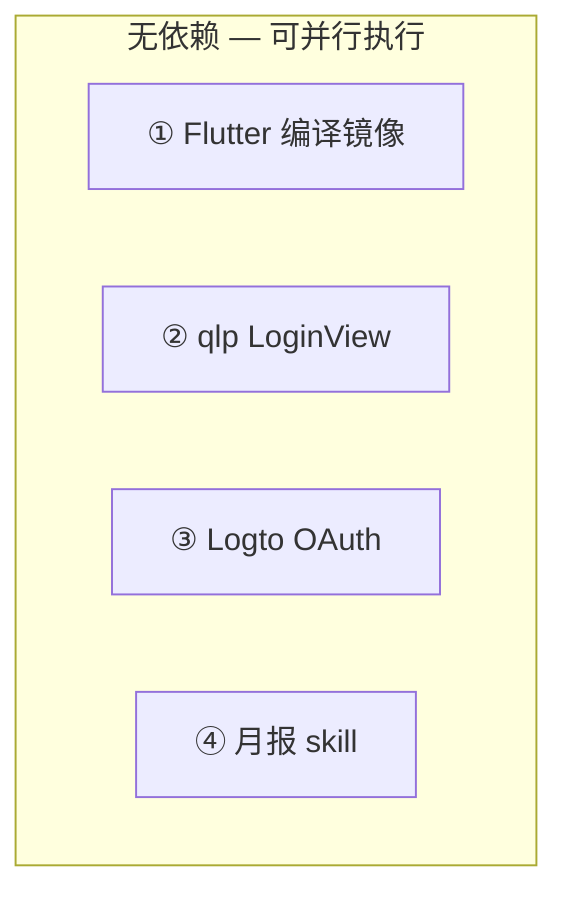

> **整理副本，改名映射见 docs/temp/mapping-approval-20260605.md，原文哈希 0db1e3ecf68a51fe456ecaeadc406124db7dcc9be59593302353c8d90f268f46。** 本文件是历史资料 A-0605-06 的公开副本；正文逐行保留原文，只按映射表改名，五个跨项目链接改指公开来源清单的历史来源标识。
>
> **历史审批不授权当前执行。** 文末“全部批准”只记录 2026-06-05 当时对四项并行计划的审批结果，不构成本项目任何 plan、tasks、spec 或实施的批准。

# 并行计划审批请求

## 基本信息
- 日期：2026-06-05 UTC+8
- 今日编号：6
- 类型：审批请求（Approval Request）
- 状态：⏳ 待审批

## 待审批计划清单

以下 4 项并行计划等待审批通过后执行：

### 🏷️ ① Flutter 编译镜像构建

| 项目 | 值 |
|------|----|
| 项目 | docker-images-flutter |
| 优先级 | P0 |
| 状态 | ⏳ 待审批 |
| **计划文件** | [📄 `[1][docker-images-flutter][flutter-ci-image-build].md`](../sources/README.md#historical-plan-1) |
| 方案 | ubuntu:22.04 + git clone Flutter stable → 推送 Gitea Packages |
| 实施步数 | 6 步 |

### 🆕 ② qlp_client LoginView 开发

| 项目 | 值 |
|------|----|
| 项目 | qlp_client |
| 优先级 | P0 |
| 状态 | ⏳ 待审批 |
| **计划文件** | [📄 `[2][qlp][login-view-dev].md`](../sources/README.md#historical-plan-2) |
| 设计稿 | login.pen ✅ 就绪，Claude Code + Pencil MCP |
| 主色 | #66CCFF |

### 🆕 ③ Logto OAuth 配置

| 项目 | 值 |
|------|----|
| 项目 | infra (AI 基础设施) |
| 优先级 | P0 |
| 状态 | ⏳ 待审批 |
| **计划文件** | [📄 `[3][infra][logto-oauth-config].md`](../sources/README.md#historical-plan-3) |
| 部署状态 | Logto 已部署 ✅ |
| 范围 | Gitea OAuth + qlp OAuth + Nginx 反代 |

### 🆕 ④ 月报生成 skill

| 项目 | 值 |
|------|----|
| 项目 | info (信息科) |
| 优先级 | P1 |
| 状态 | ⏳ 待审批 |
| **计划文件** | [📄 `[4][info][monthly-report-skill].md`](../sources/README.md#historical-plan-4) |
| 格式 | 本月工作 + 下月工作 + 工作总结，≤500 字 |

## ⏸️ 暂缓计划

| 计划 | 原因 | 文件 |
|:----|:-----|:----|
| CHIMA 会议总结 | 等待后续执行 | [📄 `[5][info][chima-conference-summary].md`](../sources/README.md#historical-plan-5) |

## 依赖关系

> 4 项计划之间无相互依赖，可完全并行推进。
> 审批通过后立即同步执行。

## 审批结果

- [x] ✅ 全部批准
- [ ] 🔄 需要修改
- [ ] ⏸️ 部分暂缓

---

*Generated by 历史维护者 @ 泠鱼科技（LingKoiTech）*

*Plan ID: [6][审批][并行计划待审批]*
